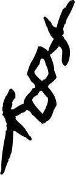

# obs-char-000102 甲骨字档案

状态：已释字候选（HUST-OBC 数据集类别，未经交叉复核） | 释读史：未收集 | 例句：0 | 更新：2026-11-02

## 1 字形与观察

- 图 1：HUST-OBC 已释字第 0113_0114 类的一张样本，125 × 288 像素〔来源 src-hust-obc `HUST-OBC/deciphered/0113_0114/0113/Y_0113_612B8.jpg`〕。
- 该类别由 2 个来源子类合并而成〔来源 src-hust-obc Validation_label.json〕。
- 观察：放大图像沿斜向排列，有三个依次相连的弧形围合，并有长下行笔画。

## 2 隶定与今字候选

- HUST-OBC 给本类的标签是“㑧㑨”（U+3467;U+3468）。这是数据集标签，不是经复核的释读〔来源 src-hust-obc Validation_label.json〕。
- 按码位对照，OBIMD 与 EvoBC 中都没有相同码位的条目〔来源 corpus/001 登记表 011〕。

## 10 来源与权利

- 来源 src-hust-obc，图片资产 `asset-000107`，权利状态 `source_marked_risk_noted`。HUST-OBC 的 Figshare 与期刊页面许可表述不一致，详见来源档案 `corpus/006_research-sources-and-bibliography/001_source-objects/015_src-hust-obc_source-object/`。
- 图片 SHA-256：`8f281141cd1e24c730cfe118010fd16130e9f05b67f9099c520d478a7f4766ae`；来源包 `large-src-000001`。

## 11 待查项

- 在小学堂甲骨文字编中查找与数据集标签“㑧㑨”对应的字头，记录释读、提出者和出处。
