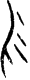

# obs-char-000230 甲骨字档案

状态：已释字候选（HUST-OBC 数据集类别，未经交叉复核） | 释读史：未收集 | 例句：2 | 更新：2026-11-02

## 1 字形与观察

- 图 1：HUST-OBC 已释字第 0256 类的一张样本，30 × 80 像素〔来源 src-hust-obc `HUST-OBC/deciphered/0256/G_0256_乙1239反.png`〕。
- 观察：狭长图像有长中央下行笔，左侧展开数道短弯曲侧笔。

## 2 隶定与今字候选

- HUST-OBC 官方对照表给本类的字是“勿”（U+52FF）。这是数据集标注，不是本项目复核过的释读〔来源 src-hust-obc `HUST-OBC/deciphered/ID_to_chinese.json`〕。
- OBIMD 主字表中有 1 个字形被隶定为同一字（UID：6ewkk2w7r1），可据此查找卜辞字例〔来源 src-obimd 主字表〕。
- EvoBC 有 1 个类别标为同一字（evobc-evo-cat-01323），可用于跨时期字形比较〔来源 src-evobc〕。
- 更正：本档案 2026-11-02 合并时曾写作“㓶”。那是早期流程把本类号错接到 HUST-OBC OCR 字表的结果，已按官方对照表更正。

## 4 卜辞例句

以下例句取自 OBIMD 标注，按其阅读顺序排列；□ 为未识别或残缺字，◇ 为 OBIMD 自造字。片号 H 后的数字推定为《合集》号，尚待逐片核对（见案件 `case-h2-heji2`）。

| OBIMD 片号 | 释文（OBIMD） | 本字位置 | 来源 |
| --- | --- | --- | --- |
| H16 | 辛丑卜爭貞我卜多不吉勿□ | 第 11/12 字 | src-obimd H16 句组 2 |
| H26 | 丁未卜爭貞勿令畢以眾伐𢀛 | 第 6/12 字 | src-obimd H26 句组 1 |

- 其他字例所在甲骨：H27、H28、H39、H40、H41、H78、H105、H109、H122、H125等〔来源 src-obimd〕。

## 5 分布

- OBIMD 中共 576 个字例，见于 544 片甲骨；按句组类别：卜辞句 576〔来源 src-obimd，统计表 `corpus/002_oracle-bone-inscriptions/010_inscription-texts/002_obimd-glyph-occurrence-stats.csv`〕。
- 同一句组中最常一起出现的字：貞（351）、于（116）、卜（101）、王（91）、㞢（56）、乎（54）。
- OBIMD 没有分期和组类字段，分期分布尚待《合集》分期表或小学堂材料来源表补入。

## 8 实物与出土（著录线索）

样本文件名 `G_0256_乙1239反.png` 带有著录线索。以下只是文件名解析结果，尚未在著录中核对：

- 旧著录：乙1239。简称“乙”未在小学堂附录简称表中找到。
- 组类或附注（文件名原文）：反
- 小学堂甲骨文字编字号 1134，共 28 个字形〔来源 src-xiaoxuetang-jiaguwen，字号查询〕。
- 旧著录样例：甲640、甲775、甲803、甲1839、乙1239反、乙2373。
- 合集号样例：合28591、合29517、合27412。
- 类组（字形条目计数）：賓組4、出組3、無名組1、組1。
- 《甲骨文字詁林》册页：3.2613〔来源 src-xiaoxuetang-jiaguwen〕。

## 10 来源与权利

- 来源 src-hust-obc，图片资产 `asset-000235`，权利状态 `source_marked_risk_noted`。HUST-OBC 的 Figshare 与期刊页面许可表述不一致，详见来源档案 `corpus/006_research-sources-and-bibliography/001_source-objects/015_src-hust-obc_source-object/`。
- 图片 SHA-256：`a88e6294e39ab391ba1c3ce2994fe262268b28e4d927a023f2303c2ab32ef876`；来源包 `large-src-000001`。

## 11 待查项

- 在拓片上核对例句中本字的写法是否与本档案字形图一致；OBIMD 把它们隶定为同一字，不等于字形相同。
- 核对旧著录“乙1239”的原拓，确认简称所指的书目，以及它与合集号的对应。
- 在《甲骨文字詁林》相应册页（3.2613）查该字的释读与提出者，记录释读、提出者和出处。
