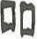

# obs-char-000289 甲骨字档案

状态：已释字候选（HUST-OBC 数据集类别，未经交叉复核） | 释读史：未收集 | 例句：0 | 更新：2026-11-02

## 1 字形与观察

- 图 1：HUST-OBC 已释字第 0327_0328 类的一张样本，42 × 44 像素〔来源 src-hust-obc `HUST-OBC/deciphered/0327_0328/0327/L_0327_5213.jpg`〕。
- 该类别由 2 个来源子类合并而成〔来源 src-hust-obc Validation_label.json〕。
- 观察：图像显示两个相邻的深色块状闭合轮廓，各自带有狭窄的内部竖向条痕，下缘略不规则。

## 2 隶定与今字候选

- HUST-OBC 官方对照表给本类的字是“吅”（U+5405）、“鄰”（U+9130）。这是数据集标注，不是本项目复核过的释读〔来源 src-hust-obc `HUST-OBC/deciphered/ID_to_chinese.json`〕。
- OBIMD 主字表中有 1 个字形被隶定为同一字（UID：9nd2ajl4nx），可据此查找卜辞字例〔来源 src-obimd 主字表〕。
- EvoBC 有 2 个类别标为同一字（evobc-evo-cat-01493、evobc-evo-cat-09216），可用于跨时期字形比较〔来源 src-evobc〕。
- 更正：本档案 2026-11-02 合并时曾写作“㔽㔾”。那是早期流程把本类号错接到 HUST-OBC OCR 字表的结果，已按官方对照表更正。

## 4 卜辞例句

- 其他字例所在甲骨：H15351〔来源 src-obimd〕。

## 5 分布

- OBIMD 中共 1 个字例，见于 1 片甲骨；按句组类别：卜辞句 1〔来源 src-obimd，统计表 `corpus/002_oracle-bone-inscriptions/010_inscription-texts/002_obimd-glyph-occurrence-stats.csv`〕。
- 同一句组中最常一起出现的字：于（1）、埶（1）、往（1）、貞（1）、允（1）、其（1）。
- OBIMD 没有分期和组类字段，分期分布尚待《合集》分期表或小学堂材料来源表补入。

## 10 来源与权利

- 来源 src-hust-obc，图片资产 `asset-000294`，权利状态 `source_marked_risk_noted`。HUST-OBC 的 Figshare 与期刊页面许可表述不一致，详见来源档案 `corpus/006_research-sources-and-bibliography/001_source-objects/015_src-hust-obc_source-object/`。
- 图片 SHA-256：`023d2f2d68cccd89081371cb7a6643d90dd54bbd24e0457fc31630413da352cd`；来源包 `large-src-000001`。

## 11 待查项

- 在拓片上核对例句中本字的写法是否与本档案字形图一致；OBIMD 把它们隶定为同一字，不等于字形相同。
- 在小学堂甲骨文字编中查找字头“吅鄰”，核对字形是否与本类样本一致，记录释读、提出者和出处。
