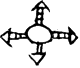

# obs-char-000360 甲骨字档案

状态：已释字候选（HUST-OBC 数据集类别，未经交叉复核） | 释读史：未收集 | 例句：2 | 更新：2026-11-02

## 1 字形与观察

- 图 1：HUST-OBC 已释字第 0409_0410 类的一张样本，80 × 68 像素〔来源 src-hust-obc `HUST-OBC/deciphered/0409_0410/0409/G_0409_京都3241(甲).png`〕。
- 该类别由 2 个来源子类合并而成〔来源 src-hust-obc Validation_label.json〕。
- 观察：中部圆弧闭合轮廓被横竖笔画交叉，四个方向均有尖状形体延伸。

## 2 隶定与今字候选

- HUST-OBC 官方对照表给本类的字是“墉”（U+5889）、“𩫏”（U+29ACF）。这是数据集标注，不是本项目复核过的释读〔来源 src-hust-obc `HUST-OBC/deciphered/ID_to_chinese.json`〕。
- OBIMD 主字表中有 1 个字形被隶定为同一字（UID：wujt49n5q0），可据此查找卜辞字例〔来源 src-obimd 主字表〕。
- EvoBC 有 2 个类别标为同一字（evobc-evo-cat-01935、evobc-evo-cat-12670），可用于跨时期字形比较〔来源 src-evobc〕。
- 更正：本档案 2026-11-02 合并时曾写作“㖏㖐”。那是早期流程把本类号错接到 HUST-OBC OCR 字表的结果，已按官方对照表更正。

## 4 卜辞例句

以下例句取自 OBIMD 标注，按其阅读顺序排列；□ 为未识别或残缺字，◇ 为 OBIMD 自造字。片号 H 后的数字推定为《合集》号，尚待逐片核对（见案件 `case-h2-heji2`）。

| OBIMD 片号 | 释文（OBIMD） | 本字位置 | 来源 |
| --- | --- | --- | --- |
| H553 | 癸丑卜賓貞令彗墉以□執寇七月 | 第 8/14 字 | src-obimd H553 句组 4 |
| H8235 | 貞彗眔墉弗其以㞢取 | 第 4/9 字 | src-obimd H8235 句组 1 |

- 其他字例所在甲骨：H1617、H8952、H9381、H13516、H29793、H29794、H29796、H29800、H29801、H30198等〔来源 src-obimd〕。

## 5 分布

- OBIMD 中共 17 个字例，见于 15 片甲骨；按句组类别：卜辞句 17〔来源 src-obimd，统计表 `corpus/002_oracle-bone-inscriptions/010_inscription-texts/002_obimd-glyph-occurrence-stats.csv`〕。
- 同一句组中最常一起出现的字：雨（7）、至（6）、貞（5）、不（5）、兮（5）、卜（4）。
- OBIMD 没有分期和组类字段，分期分布尚待《合集》分期表或小学堂材料来源表补入。

## 8 实物与出土（著录线索）

样本文件名 `G_0409_京都3241(甲).png` 带有著录线索。以下只是文件名解析结果，尚未在著录中核对：

- 旧著录：京都3241。简称“京都”在小学堂《合集材料来源表》附录中对应《京都大學人文科學研究所藏甲骨文字》；HUST 文件名是否沿用同一体例尚未核实〔来源 src-xiaoxuetang-obm〕。
- 组类或附注（文件名原文）：(甲)

## 10 来源与权利

- 来源 src-hust-obc，图片资产 `asset-000365`，权利状态 `source_marked_risk_noted`。HUST-OBC 的 Figshare 与期刊页面许可表述不一致，详见来源档案 `corpus/006_research-sources-and-bibliography/001_source-objects/015_src-hust-obc_source-object/`。
- 图片 SHA-256：`2fca3f23486740000ea43c8d1012248486371ce014031010fbe2b187a5d98b5c`；来源包 `large-src-000001`。

## 11 待查项

- 在拓片上核对例句中本字的写法是否与本档案字形图一致；OBIMD 把它们隶定为同一字，不等于字形相同。
- 核对旧著录“京都3241”的原拓，确认简称所指的书目，以及它与合集号的对应。
- 在小学堂甲骨文字编中查找字头“墉𩫏”，核对字形是否与本类样本一致，记录释读、提出者和出处。
