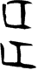

# obs-char-000372 甲骨字档案

状态：已释字候选（HUST-OBC 数据集类别，未经交叉复核） | 释读史：未收集 | 例句：2 | 更新：2026-11-02

## 1 字形与观察

- 图 1：HUST-OBC 已释字第 0423 类的一张样本，44 × 80 像素〔来源 src-hust-obc `HUST-OBC/deciphered/0423/G_0423_乙2040合816賓組.png`〕。
- 观察：宽大的下部闭合轮廓上方有短横笔画，另有一条较长上部痕迹。

## 2 隶定与今字候选

- HUST-OBC 官方对照表给本类的字是“多”（U+591A）。这是数据集标注，不是本项目复核过的释读〔来源 src-hust-obc `HUST-OBC/deciphered/ID_to_chinese.json`〕。
- OBIMD 主字表中有 1 个字形被隶定为同一字（UID：ex96ntmoie），可据此查找卜辞字例〔来源 src-obimd 主字表〕。
- EvoBC 有 1 个类别标为同一字（evobc-evo-cat-02002），可用于跨时期字形比较〔来源 src-evobc〕。
- 更正：本档案 2026-11-02 合并时曾写作“㖝”。那是早期流程把本类号错接到 HUST-OBC OCR 字表的结果，已按官方对照表更正。

## 4 卜辞例句

以下例句取自 OBIMD 标注，按其阅读顺序排列；□ 为未识别或残缺字，◇ 为 OBIMD 自造字。片号 H 后的数字推定为《合集》号，尚待逐片核对（见案件 `case-h2-heji2`）。

| OBIMD 片号 | 释文（OBIMD） | 本字位置 | 来源 |
| --- | --- | --- | --- |
| H16 | 辛丑卜爭貞我卜多不吉勿□ | 第 8/12 字 | src-obimd H16 句组 2 |
| H69 | 貞多射不矢眾 | 第 2/6 字 | src-obimd H69 句组 1 |

- 其他字例所在甲骨：H155、H156、H157、H159、H176、H202、H542、H547、H614、H615等〔来源 src-obimd〕。

## 5 分布

- OBIMD 中共 136 个字例，见于 128 片甲骨；按句组类别：卜辞句 136〔来源 src-obimd，统计表 `corpus/002_oracle-bone-inscriptions/010_inscription-texts/002_obimd-glyph-occurrence-stats.csv`〕。
- 同一句组中最常一起出现的字：貞（62）、卜（44）、于（26）、乎（24）、其（18）、◇（17）。
- OBIMD 没有分期和组类字段，分期分布尚待《合集》分期表或小学堂材料来源表补入。

## 8 实物与出土（著录线索）

样本文件名 `G_0423_乙2040合816賓組.png` 带有著录线索。以下只是文件名解析结果，尚未在著录中核对：

- 合集号：合816
- 旧著录：乙2040。简称“乙”未在小学堂附录简称表中找到。
- 组类或附注（文件名原文）：賓組
- 小学堂甲骨文字编字号 849，共 47 个字形〔来源 src-xiaoxuetang-jiaguwen，字号查询〕。
- 旧著录样例：甲565、甲752、甲815、甲918、甲1167、甲2128。
- 合集号样例：合27492、合27894、合32810。
- 类组（字形条目计数）：賓組13、黃組4、出組2、歷組2。
- 《甲骨文字詁林》册页：4.3324〔来源 src-xiaoxuetang-jiaguwen〕。

## 10 来源与权利

- 来源 src-hust-obc，图片资产 `asset-000377`，权利状态 `source_marked_risk_noted`。HUST-OBC 的 Figshare 与期刊页面许可表述不一致，详见来源档案 `corpus/006_research-sources-and-bibliography/001_source-objects/015_src-hust-obc_source-object/`。
- 图片 SHA-256：`603fea6b287a13f65bf80b8314f4cea4af9f899d3959c9de7836f859a1e0eb30`；来源包 `large-src-000001`。

## 11 待查项

- 在拓片上核对例句中本字的写法是否与本档案字形图一致；OBIMD 把它们隶定为同一字，不等于字形相同。
- 在《甲骨文合集》816 号（文件名写作“合816”）上找到本字例，抄录所在卜辞全文并标出字位。
- 核对旧著录“乙2040”的原拓，确认简称所指的书目，以及它与合集号的对应。
- 在《甲骨文字詁林》相应册页（4.3324）查该字的释读与提出者，记录释读、提出者和出处。
