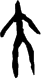

# obs-char-000375 甲骨字档案

状态：已释字候选（HUST-OBC 数据集类别，未经交叉复核） | 释读史：未收集 | 例句：0 | 更新：2026-11-02

## 1 字形与观察

- 图 1：HUST-OBC 已释字第 0427 类的一张样本，43 × 80 像素〔来源 src-hust-obc `HUST-OBC/deciphered/0427/G_0427_乙2494合3216賓組.png`〕。
- 观察：尖状上部分叉向下展开为两条长下行笔画，中间有一条狭长笔画。

## 2 隶定与今字候选

- HUST-OBC 官方对照表给本类的字是“大”（U+5927）。这是数据集标注，不是本项目复核过的释读〔来源 src-hust-obc `HUST-OBC/deciphered/ID_to_chinese.json`〕。
- OBIMD 主字表中有 1 个字形被隶定为同一字（UID：s9y9vbblxa），可据此查找卜辞字例〔来源 src-obimd 主字表〕。
- EvoBC 有 1 个类别标为同一字（evobc-evo-cat-02008），可用于跨时期字形比较〔来源 src-evobc〕。
- 更正：本档案 2026-11-02 合并时曾写作“㖡”。那是早期流程把本类号错接到 HUST-OBC OCR 字表的结果，已按官方对照表更正。
## 8 实物与出土（著录线索）

样本文件名 `G_0427_乙2494合3216賓組.png` 带有著录线索。以下只是文件名解析结果，尚未在著录中核对：

- 合集号：合3216
- 旧著录：乙2494。简称“乙”未在小学堂附录简称表中找到。
- 组类或附注（文件名原文）：賓組

## 10 来源与权利

- 来源 src-hust-obc，图片资产 `asset-000380`，权利状态 `source_marked_risk_noted`。HUST-OBC 的 Figshare 与期刊页面许可表述不一致，详见来源档案 `corpus/006_research-sources-and-bibliography/001_source-objects/015_src-hust-obc_source-object/`。
- 图片 SHA-256：`4712ef2bca01585d3a2542d2f3e67e2cd2c80eaa29b1678340d05ea6f42f600e`；来源包 `large-src-000001`。

## 11 待查项

- 从 OBIMD 卜辞语料中取出这些 UID 的全部字例，抄录带著录号的例句，统计分期与共现字。
- 在《甲骨文合集》3216 号（文件名写作“合3216”）上找到本字例，抄录所在卜辞全文并标出字位。
- 核对旧著录“乙2494”的原拓，确认简称所指的书目，以及它与合集号的对应。
- 在小学堂甲骨文字编中查找字头“大”，核对字形是否与本类样本一致，记录释读、提出者和出处。
