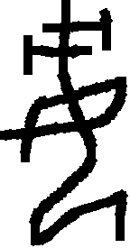

# obs-char-000402 甲骨字档案

状态：已释字候选（HUST-OBC 数据集类别，未经交叉复核） | 释读史：未收集 | 例句：0 | 更新：2026-11-02

## 1 字形与观察

- 图 1：HUST-OBC 已释字第 0455_0456 类的一张样本，144 × 275 像素〔来源 src-hust-obc `HUST-OBC/deciphered/0455_0456/0455/H_0455_6021A_0.png`〕。
- 该类别由 2 个来源子类合并而成〔来源 src-hust-obc Validation_label.json〕。
- 观察：粗重竖向痕迹穿过上部矩形组合、中部椭圆闭合轮廓和大型折角下部环形轮廓。

## 2 隶定与今字候选

- HUST-OBC 给本类的标签是“㖽㖾”（U+35BD;U+35BE）。这是数据集标签，不是经复核的释读〔来源 src-hust-obc Validation_label.json〕。
- 按码位对照，OBIMD 与 EvoBC 中都没有相同码位的条目〔来源 corpus/001 登记表 011〕。

## 10 来源与权利

- 来源 src-hust-obc，图片资产 `asset-000407`，权利状态 `source_marked_risk_noted`。HUST-OBC 的 Figshare 与期刊页面许可表述不一致，详见来源档案 `corpus/006_research-sources-and-bibliography/001_source-objects/015_src-hust-obc_source-object/`。
- 图片 SHA-256：`a4419da22eb827fed3d9e2d5208998733b20aad2490e607f2a9581385541ab3b`；来源包 `large-src-000001`。

## 11 待查项

- 在小学堂甲骨文字编中查找与数据集标签“㖽㖾”对应的字头，记录释读、提出者和出处。
