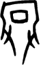

# obs-char-000431 甲骨字档案

状态：已释字候选（HUST-OBC 数据集类别，未经交叉复核） | 释读史：未收集 | 例句：2 | 更新：2026-11-02

## 1 字形与观察

- 图 1：HUST-OBC 已释字第 0489_0490_0491 类的一张样本，60 × 95 像素〔来源 src-hust-obc `HUST-OBC/deciphered/0489_0490_0491/0489/G_0489_甲骨文0.png`〕。
- 该类别由 3 个来源子类合并而成〔来源 src-hust-obc Validation_label.json〕。
- 观察：大型外部围框包围较小内矩形，下部两侧各有分离的分叉或折角延伸。

## 2 隶定与今字候选

- HUST-OBC 官方对照表给本类的字是“娩”（U+5A29）、“冥”（U+51A5）、“㝃”（U+3743）。这是数据集标注，不是本项目复核过的释读〔来源 src-hust-obc `HUST-OBC/deciphered/ID_to_chinese.json`〕。
- OBIMD 主字表中有 1 个字形被隶定为同一字（UID：r90d2o0i9y），可据此查找卜辞字例〔来源 src-obimd 主字表〕。
- EvoBC 有 3 个类别标为同一字（evobc-evo-cat-00065、evobc-evo-cat-01133、evobc-evo-cat-02178），可用于跨时期字形比较〔来源 src-evobc〕。
- 更正：本档案 2026-11-02 合并时曾写作“㗟㗠㗡”。那是早期流程把本类号错接到 HUST-OBC OCR 字表的结果，已按官方对照表更正。

## 4 卜辞例句

以下例句取自 OBIMD 标注，按其阅读顺序排列；□ 为未识别或残缺字，◇ 为 OBIMD 自造字。片号 H 后的数字推定为《合集》号，尚待逐片核对（见案件 `case-h2-heji2`）。

| OBIMD 片号 | 释文（OBIMD） | 本字位置 | 来源 |
| --- | --- | --- | --- |
| H181 | 乙巳卜賓貞帚妌娩𰋶□帚妌 | 第 8/12 字 | src-obimd H181 句组 1 |
| H7843 | 丁酉卜殻貞來乙巳王入于娩 | 第 12/12 字 | src-obimd H7843 句组 1 |

- 其他字例所在甲骨：H7842、H7844、H7846、H7847、H7848、H7850、H13458、H14036、H14038、H14040等〔来源 src-obimd〕。

## 5 分布

- OBIMD 中共 18 个字例，见于 18 片甲骨；按句组类别：卜辞句 18〔来源 src-obimd，统计表 `corpus/002_oracle-bone-inscriptions/010_inscription-texts/002_obimd-glyph-occurrence-stats.csv`〕。
- 同一句组中最常一起出现的字：貞（10）、嘉（9）、卜（7）、王（6）、丁（6）、乙（5）。
- OBIMD 没有分期和组类字段，分期分布尚待《合集》分期表或小学堂材料来源表补入。

## 10 来源与权利

- 来源 src-hust-obc，图片资产 `asset-000436`，权利状态 `source_marked_risk_noted`。HUST-OBC 的 Figshare 与期刊页面许可表述不一致，详见来源档案 `corpus/006_research-sources-and-bibliography/001_source-objects/015_src-hust-obc_source-object/`。
- 图片 SHA-256：`976e93bd20f9b12ec4a7e1bf258d2a16e8dc9ec9b8ec42ba5634f1fe9900f3ae`；来源包 `large-src-000001`。

## 11 待查项

- 在拓片上核对例句中本字的写法是否与本档案字形图一致；OBIMD 把它们隶定为同一字，不等于字形相同。
- 在小学堂甲骨文字编中查找字头“娩冥㝃”，核对字形是否与本类样本一致，记录释读、提出者和出处。
