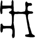

# obs-char-000626 甲骨字档案

状态：已释字候选（HUST-OBC 数据集类别，未经交叉复核） | 释读史：未收集 | 例句：0 | 更新：2026-11-02

## 1 字形与观察

- 图 1：HUST-OBC 已释字第 0711 类的一张样本，73 × 80 像素〔来源 src-hust-obc `HUST-OBC/deciphered/0711/G_0711_甲骨文.png`〕。
- 观察：两条直立干由长中横栏连接；左干带成对短侧栏，右干有叉顶和宽底脚。

## 2 隶定与今字候选

- HUST-OBC 给本类的标签是“㚽”（U+36BD）。这是数据集标签，不是经复核的释读〔来源 src-hust-obc Validation_label.json〕。
- 按码位对照，OBIMD 与 EvoBC 中都没有相同码位的条目〔来源 corpus/001 登记表 011〕。

## 8 实物与出土（著录线索）

样本文件名 `G_0711_甲骨文.png` 带有著录线索。以下只是文件名解析结果，尚未在著录中核对：

- 组类或附注（文件名原文）：甲骨文

## 10 来源与权利

- 来源 src-hust-obc，图片资产 `asset-000631`，权利状态 `source_marked_risk_noted`。HUST-OBC 的 Figshare 与期刊页面许可表述不一致，详见来源档案 `corpus/006_research-sources-and-bibliography/001_source-objects/015_src-hust-obc_source-object/`。
- 图片 SHA-256：`5d9055d581b4b94b7748e12f843a586904c4f4867db3c26004f6010c7558acc4`；来源包 `large-src-000001`。

## 11 待查项

- 在小学堂甲骨文字编中查找与数据集标签“㚽”对应的字头，记录释读、提出者和出处。
