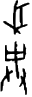

# obs-char-000662 甲骨字档案

状态：已释字候选（HUST-OBC 数据集类别，未经交叉复核） | 释读史：未收集 | 例句：2 | 更新：2026-11-02

## 1 字形与观察

- 图 1：HUST-OBC 已释字第 0750_0751 类的一张样本，32 × 97 像素〔来源 src-hust-obc `HUST-OBC/deciphered/0750_0751/0750/G_0750_甲骨文0.png`〕。
- 该类别由 2 个来源子类合并而成〔来源 src-hust-obc Validation_label.json〕。
- 观察：纤细竖向排列结合顶部交叉折角笔、小型方格状中部笔群和数条叉状下枝。

## 2 隶定与今字候选

- HUST-OBC 官方对照表给本类的字是“敢”（U+6562）、“𠭖”（U+20B56）。这是数据集标注，不是本项目复核过的释读〔来源 src-hust-obc `HUST-OBC/deciphered/ID_to_chinese.json`〕。
- OBIMD 主字表中有 1 个字形被隶定为同一字（UID：tbecf7rhkr），可据此查找卜辞字例〔来源 src-obimd 主字表〕。
- EvoBC 有 2 个类别标为同一字（evobc-evo-cat-03595、evobc-evo-cat-10923），可用于跨时期字形比较〔来源 src-evobc〕。
- 更正：本档案 2026-11-02 合并时曾写作“㛤㛥”。那是早期流程把本类号错接到 HUST-OBC OCR 字表的结果，已按官方对照表更正。

## 4 卜辞例句

以下例句取自 OBIMD 标注，按其阅读顺序排列；□ 为未识别或残缺字，◇ 为 OBIMD 自造字。片号 H 后的数字推定为《合集》号，尚待逐片核对（见案件 `case-h2-heji2`）。

| OBIMD 片号 | 释文（OBIMD） | 本字位置 | 来源 |
| --- | --- | --- | --- |
| H224 | □卜亘貞敢羌 | 第 5/6 字 | src-obimd H224 句组 1 |
| H5410 | 癸未卜殻貞王敢□□若◇ | 第 7/11 字 | src-obimd H5410 句组 1 |

- 其他字例所在甲骨：H225、H6538、H6941、H7678、H8216、H8217、H10704、H10706、H10707、H10709等〔来源 src-obimd〕。

## 5 分布

- OBIMD 中共 22 个字例，见于 21 片甲骨；按句组类别：卜辞句 22〔来源 src-obimd，统计表 `corpus/002_oracle-bone-inscriptions/010_inscription-texts/002_obimd-glyph-occurrence-stats.csv`〕。
- 同一句组中最常一起出现的字：貞（11）、卜（6）、其（4）、勿（4）、王（3）、甲（3）。
- OBIMD 没有分期和组类字段，分期分布尚待《合集》分期表或小学堂材料来源表补入。

## 10 来源与权利

- 来源 src-hust-obc，图片资产 `asset-000667`，权利状态 `source_marked_risk_noted`。HUST-OBC 的 Figshare 与期刊页面许可表述不一致，详见来源档案 `corpus/006_research-sources-and-bibliography/001_source-objects/015_src-hust-obc_source-object/`。
- 图片 SHA-256：`0a9720419a8880ea469fd606b0dedae699a42ce83657be2767389b14c4f37fa3`；来源包 `large-src-000001`。

## 11 待查项

- 在拓片上核对例句中本字的写法是否与本档案字形图一致；OBIMD 把它们隶定为同一字，不等于字形相同。
- 在小学堂甲骨文字编中查找字头“敢𠭖”，核对字形是否与本类样本一致，记录释读、提出者和出处。
