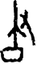

# obs-char-000698 甲骨字档案

状态：已释字候选（HUST-OBC 数据集类别，未经交叉复核） | 释读史：未收集 | 例句：0 | 更新：2026-11-02

## 1 字形与观察

- 图 1：HUST-OBC 已释字第 0792 类的一张样本，46 × 80 像素〔来源 src-hust-obc `HUST-OBC/deciphered/0792/G_0792_合22942出組.png`〕。
- 观察：高长左竖在中部出枝，并连接底部圆角矩形环；右侧另有纤细分枝斜笔下垂。

## 2 隶定与今字候选

- HUST-OBC 给本类的标签是“㜎”（U+370E）。这是数据集标签，不是经复核的释读〔来源 src-hust-obc Validation_label.json〕。
- 按码位对照，EvoBC 中有相同码位的条目〔来源 corpus/001 登记表 011〕。

## 8 实物与出土（著录线索）

样本文件名 `G_0792_合22942出組.png` 带有著录线索。以下只是文件名解析结果，尚未在著录中核对：

- 合集号：合22942
- 组类或附注（文件名原文）：出組

## 10 来源与权利

- 来源 src-hust-obc，图片资产 `asset-000703`，权利状态 `source_marked_risk_noted`。HUST-OBC 的 Figshare 与期刊页面许可表述不一致，详见来源档案 `corpus/006_research-sources-and-bibliography/001_source-objects/015_src-hust-obc_source-object/`。
- 图片 SHA-256：`fc9fbb7d10e122d86e1aa364f78e927e3c2507a91e3c9576aa4ac49144d6a1a6`；来源包 `large-src-000001`。

## 11 待查项

- 在《甲骨文合集》22942 号（文件名写作“合22942”）上找到本字例，抄录所在卜辞全文并标出字位。
- 在小学堂甲骨文字编中查找与数据集标签“㜎”对应的字头，记录释读、提出者和出处。
