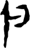

# obs-char-000797 甲骨字档案

状态：已释字候选（HUST-OBC 数据集类别，未经交叉复核） | 释读史：未收集 | 例句：2 | 更新：2026-11-02

## 1 字形与观察

- 图 1：HUST-OBC 已释字第 0902_0903 类的一张样本，52 × 80 像素〔来源 src-hust-obc `HUST-OBC/deciphered/0902_0903/0902/G_0902_乙804合22206𠂤組.png`〕。
- 该类别由 2 个来源子类合并而成〔来源 src-hust-obc Validation_label.json〕。
- 观察：深色狭长左竖通过短横连接右侧圆弯开口环；左侧继续延伸为长尖下尾。

## 2 隶定与今字候选

- HUST-OBC 官方对照表给本类的字是“歲”（U+6B72）、“嵗”（U+5D57）。这是数据集标注，不是本项目复核过的释读〔来源 src-hust-obc `HUST-OBC/deciphered/ID_to_chinese.json`〕。
- OBIMD 主字表中有 1 个字形被隶定为同一字（UID：ghln7uplih），可据此查找卜辞字例〔来源 src-obimd 主字表〕。
- EvoBC 有 2 个类别标为同一字（evobc-evo-cat-02582、evobc-evo-cat-04396），可用于跨时期字形比较〔来源 src-evobc〕。
- 更正：本档案 2026-11-02 合并时曾写作“㝼㝽”。那是早期流程把本类号错接到 HUST-OBC OCR 字表的结果，已按官方对照表更正。

## 4 卜辞例句

以下例句取自 OBIMD 标注，按其阅读顺序排列；□ 为未识别或残缺字，◇ 为 OBIMD 自造字。片号 H 后的数字推定为《合集》号，尚待逐片核对（见案件 `case-h2-heji2`）。

| OBIMD 片号 | 释文（OBIMD） | 本字位置 | 来源 |
| --- | --- | --- | --- |
| H313 | 貞翌乙亥㞢◇歲于唐卌羌卯卅牛◇ | 第 7/15 字 | src-obimd H313 句组 2 |
| H377 | 庚辰卜貞卒◇歲乍◇自且乙至于丁◇ | 第 7/16 字 | src-obimd H377 句组 2 |

- 其他字例所在甲骨：H319、H401、H421、H1343、H1849、H1964、H1967、H2049、H2596、H3073等〔来源 src-obimd〕。

## 5 分布

- OBIMD 中共 558 个字例，见于 421 片甲骨；按句组类别：卜辞句 557，未定 1〔来源 src-obimd，统计表 `corpus/002_oracle-bone-inscriptions/010_inscription-texts/002_obimd-glyph-occurrence-stats.csv`〕。
- 同一句组中最常一起出现的字：卜（199）、貞（152）、佑（117）、一（116）、于（104）、牢（91）。
- OBIMD 没有分期和组类字段，分期分布尚待《合集》分期表或小学堂材料来源表补入。

## 8 实物与出土（著录线索）

样本文件名 `G_0902_乙804合22206𠂤組.png` 带有著录线索。以下只是文件名解析结果，尚未在著录中核对：

- 合集号：合22206
- 旧著录：乙804。简称“乙”未在小学堂附录简称表中找到。
- 组类或附注（文件名原文）：𠂤組
- 小学堂甲骨文字编字号 161，共 55 个字形〔来源 src-xiaoxuetang-jiaguwen，字号查询〕。
- 旧著录样例：餘1.1、明2235、鐵80.4、甲96、甲103、甲3915。
- 合集号样例：合13475、合25176、合25178。
- 类组（字形条目计数）：歷組6、無名組4、出組3、𠂤組3。
- 《甲骨文字詁林》册页：3.2395、3.2425〔来源 src-xiaoxuetang-jiaguwen〕。

## 10 来源与权利

- 来源 src-hust-obc，图片资产 `asset-000802`，权利状态 `source_marked_risk_noted`。HUST-OBC 的 Figshare 与期刊页面许可表述不一致，详见来源档案 `corpus/006_research-sources-and-bibliography/001_source-objects/015_src-hust-obc_source-object/`。
- 图片 SHA-256：`3060e606e5260f5c35c995321b7398004d2c93c22dd9994b16e94398c2b1d039`；来源包 `large-src-000001`。

## 11 待查项

- 在拓片上核对例句中本字的写法是否与本档案字形图一致；OBIMD 把它们隶定为同一字，不等于字形相同。
- 在《甲骨文合集》22206 号（文件名写作“合22206”）上找到本字例，抄录所在卜辞全文并标出字位。
- 核对旧著录“乙804”的原拓，确认简称所指的书目，以及它与合集号的对应。
- 在《甲骨文字詁林》相应册页（3.2395、3.2425）查该字的释读与提出者，记录释读、提出者和出处。
