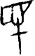

# obs-char-000814 甲骨字档案

状态：已释字候选（HUST-OBC 数据集类别，未经交叉复核） | 释读史：未收集 | 例句：0 | 更新：2026-11-02

## 1 字形与观察

- 图 1：HUST-OBC 已释字第 0922 类的一张样本，50 × 80 像素〔来源 src-hust-obc `HUST-OBC/deciphered/0922/G_0922_明1633(甲).png`〕。
- 观察：上部形成浅平不规则框形并有数条短竖笔；下中部有横笔横过，下方延伸竖干。

## 2 隶定与今字候选

- HUST-OBC 官方对照表给本类的字是“民”（U+6C11）。这是数据集标注，不是本项目复核过的释读〔来源 src-hust-obc `HUST-OBC/deciphered/ID_to_chinese.json`〕。
- OBIMD 主字表中有 1 个字形被隶定为同一字（UID：zjs0019zm2），可据此查找卜辞字例〔来源 src-obimd 主字表〕。
- EvoBC 有 1 个类别标为同一字（evobc-evo-cat-04470），可用于跨时期字形比较〔来源 src-evobc〕。
- 更正：本档案 2026-11-02 合并时曾写作“㞐”。那是早期流程把本类号错接到 HUST-OBC OCR 字表的结果，已按官方对照表更正。

## 4 卜辞例句

- 其他字例所在甲骨：H18272〔来源 src-obimd〕。

## 5 分布

- OBIMD 中共 1 个字例，见于 1 片甲骨；按句组类别：卜辞句 1〔来源 src-obimd，统计表 `corpus/002_oracle-bone-inscriptions/010_inscription-texts/002_obimd-glyph-occurrence-stats.csv`〕。
- 同一句组中最常一起出现的字：王（1）、口（1）、伇（1）。
- OBIMD 没有分期和组类字段，分期分布尚待《合集》分期表或小学堂材料来源表补入。

## 8 实物与出土（著录线索）

样本文件名 `G_0922_明1633(甲).png` 带有著录线索。以下只是文件名解析结果，尚未在著录中核对：

- 旧著录：明1633。简称“明”在小学堂《合集材料来源表》附录中对应《明義士收藏甲骨》；HUST 文件名是否沿用同一体例尚未核实〔来源 src-xiaoxuetang-obm〕。
- 组类或附注（文件名原文）：(甲)

## 10 来源与权利

- 来源 src-hust-obc，图片资产 `asset-000819`，权利状态 `source_marked_risk_noted`。HUST-OBC 的 Figshare 与期刊页面许可表述不一致，详见来源档案 `corpus/006_research-sources-and-bibliography/001_source-objects/015_src-hust-obc_source-object/`。
- 图片 SHA-256：`ba5ae41168170d2bf0837043d071143cd8c60a9023b4d5959429c72ad0affd35`；来源包 `large-src-000001`。

## 11 待查项

- 在拓片上核对例句中本字的写法是否与本档案字形图一致；OBIMD 把它们隶定为同一字，不等于字形相同。
- 核对旧著录“明1633”的原拓，确认简称所指的书目，以及它与合集号的对应。
- 在小学堂甲骨文字编中查找字头“民”，核对字形是否与本类样本一致，记录释读、提出者和出处。
