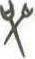

# obs-char-000827 甲骨字档案

状态：已释字候选（HUST-OBC 数据集类别，未经交叉复核） | 释读史：未收集 | 例句：0 | 更新：2026-11-02

## 1 字形与观察

- 图 1：HUST-OBC 已释字第 0935 类的一张样本，35 × 59 像素〔来源 src-hust-obc `HUST-OBC/deciphered/0935/L_0935_7356.jpg`〕。
- 观察：小型灰度交叉形中有中央斜笔，上方分出两条短枝，下方另有分离笔画。

## 2 隶定与今字候选

- HUST-OBC 给本类的标签是“㞝”（U+379D）。这是数据集标签，不是经复核的释读〔来源 src-hust-obc Validation_label.json〕。
- 按码位对照，EvoBC 中有相同码位的条目〔来源 corpus/001 登记表 011〕。

## 10 来源与权利

- 来源 src-hust-obc，图片资产 `asset-000832`，权利状态 `source_marked_risk_noted`。HUST-OBC 的 Figshare 与期刊页面许可表述不一致，详见来源档案 `corpus/006_research-sources-and-bibliography/001_source-objects/015_src-hust-obc_source-object/`。
- 图片 SHA-256：`a6d8b2f3c812fa1a510724fea30b20c4bac3677c15830caaf303b4ea88ba5653`；来源包 `large-src-000001`。

## 11 待查项

- 在小学堂甲骨文字编中查找与数据集标签“㞝”对应的字头，记录释读、提出者和出处。
