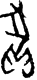

# obs-char-000946 甲骨字档案

状态：已释字候选（HUST-OBC 数据集类别，未经交叉复核） | 释读史：未收集 | 例句：0 | 更新：2026-11-02

## 1 字形与观察

- 图 1：HUST-OBC 已释字第 1063 类的一张样本，37 × 80 像素〔来源 src-hust-obc `HUST-OBC/deciphered/1063/G_1063_京都673合18370.png`〕。
- 观察：折角上部闭合轮廓连接小型圆弧下部笔群；右侧有长弯曲下行笔。

## 2 隶定与今字候选

- HUST-OBC 给本类的标签是“㠝”（U+381D）。这是数据集标签，不是经复核的释读〔来源 src-hust-obc Validation_label.json〕。
- 按码位对照，OBIMD 与 EvoBC 中都没有相同码位的条目〔来源 corpus/001 登记表 011〕。

## 8 实物与出土（著录线索）

样本文件名 `G_1063_京都673合18370.png` 带有著录线索。以下只是文件名解析结果，尚未在著录中核对：

- 合集号：合18370
- 旧著录：京都673。简称“京都”在小学堂《合集材料来源表》附录中对应《京都大學人文科學研究所藏甲骨文字》；HUST 文件名是否沿用同一体例尚未核实〔来源 src-xiaoxuetang-obm〕。

## 10 来源与权利

- 来源 src-hust-obc，图片资产 `asset-000951`，权利状态 `source_marked_risk_noted`。HUST-OBC 的 Figshare 与期刊页面许可表述不一致，详见来源档案 `corpus/006_research-sources-and-bibliography/001_source-objects/015_src-hust-obc_source-object/`。
- 图片 SHA-256：`abea12da4d727c9347254f73e6d4e7cf20530b41069e5e2eca5ca84b747a25bb`；来源包 `large-src-000001`。

## 11 待查项

- 在《甲骨文合集》18370 号（文件名写作“合18370”）上找到本字例，抄录所在卜辞全文并标出字位。
- 核对旧著录“京都673”的原拓，确认简称所指的书目，以及它与合集号的对应。
- 在小学堂甲骨文字编中查找与数据集标签“㠝”对应的字头，记录释读、提出者和出处。
