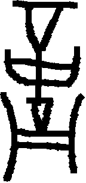

# obs-char-000958 甲骨字档案

状态：已释字候选（HUST-OBC 数据集类别，未经交叉复核） | 释读史：未收集 | 例句：1 | 更新：2026-11-02

## 1 字形与观察

- 图 1：HUST-OBC 已释字第 1077_1078 类的一张样本，144 × 304 像素〔来源 src-hust-obc `HUST-OBC/deciphered/1077_1078/1077/H_1077_60E3E_0.png`〕。
- 该类别由 2 个来源子类合并而成〔来源 src-hust-obc Validation_label.json〕。
- 观察：粗重叠置形体结合顶部横笔和倒三角状笔、中部圆弧带以及下部开放区段。

## 2 隶定与今字候选

- HUST-OBC 官方对照表给本类的字是“瓒”（U+74D2）、“瓚”（U+74DA）。这是数据集标注，不是本项目复核过的释读〔来源 src-hust-obc `HUST-OBC/deciphered/ID_to_chinese.json`〕。
- OBIMD 主字表中有 1 个字形被隶定为同一字（UID：xel4l5p8v6），可据此查找卜辞字例〔来源 src-obimd 主字表〕。
- EvoBC 有 2 个类别标为同一字（evobc-evo-cat-05495、evobc-evo-cat-05500），可用于跨时期字形比较〔来源 src-evobc〕。
- 更正：本档案 2026-11-02 合并时曾写作“㠫㠬”。那是早期流程把本类号错接到 HUST-OBC OCR 字表的结果，已按官方对照表更正。

## 4 卜辞例句

以下例句取自 OBIMD 标注，按其阅读顺序排列；□ 为未识别或残缺字，◇ 为 OBIMD 自造字。片号 H 后的数字推定为《合集》号，尚待逐片核对（见案件 `case-h2-heji2`）。

| OBIMD 片号 | 释文（OBIMD） | 本字位置 | 来源 |
| --- | --- | --- | --- |
| HD493 | 壬辰卜嚮癸巳夢丁祼巳用瓒□至艱 | 第 12/15 字 | src-obimd HD493 句组 6 |

- 其他字例所在甲骨：H2862〔来源 src-obimd〕。

## 5 分布

- OBIMD 中共 2 个字例，见于 2 片甲骨；按句组类别：卜辞句 2〔来源 src-obimd，统计表 `corpus/002_oracle-bone-inscriptions/010_inscription-texts/002_obimd-glyph-occurrence-stats.csv`〕。
- 同一句组中最常一起出现的字：帚（1）、癸（1）、嚮（1）、巳（1）、卜（1）、至（1）。
- OBIMD 没有分期和组类字段，分期分布尚待《合集》分期表或小学堂材料来源表补入。

## 10 来源与权利

- 来源 src-hust-obc，图片资产 `asset-000963`，权利状态 `source_marked_risk_noted`。HUST-OBC 的 Figshare 与期刊页面许可表述不一致，详见来源档案 `corpus/006_research-sources-and-bibliography/001_source-objects/015_src-hust-obc_source-object/`。
- 图片 SHA-256：`36841fa7ff177b2bb611690caa3dcd86fb0afce6e05b4524b528f9cd6a262a5d`；来源包 `large-src-000001`。

## 11 待查项

- 在拓片上核对例句中本字的写法是否与本档案字形图一致；OBIMD 把它们隶定为同一字，不等于字形相同。
- 在小学堂甲骨文字编中查找字头“瓒瓚”，核对字形是否与本类样本一致，记录释读、提出者和出处。
