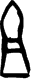

# obs-char-001045 甲骨字档案

状态：已释字候选（HUST-OBC 数据集类别，未经交叉复核） | 释读史：未收集 | 例句：2 | 更新：2026-11-02

## 1 字形与观察

- 图 1：HUST-OBC 已释字第 1171_1172 类的一张样本，33 × 80 像素〔来源 src-hust-obc `HUST-OBC/deciphered/1171_1172/1171/G_1171_前1.9.6(甲).png`〕。
- 该类别由 2 个来源子类合并而成〔来源 src-hust-obc Validation_label.json〕。
- 观察：狭长叠置形体结合尖状圆弧上部闭合轮廓、横向中部带和下部梯形状闭合轮廓。

## 2 隶定与今字候选

- HUST-OBC 官方对照表给本类的字是“祖”（U+7956）、“且”（U+4E14）。这是数据集标注，不是本项目复核过的释读〔来源 src-hust-obc `HUST-OBC/deciphered/ID_to_chinese.json`〕。
- OBIMD 主字表中有 1 个字形被隶定为同一字（UID：z640bkv6r7），可据此查找卜辞字例〔来源 src-obimd 主字表〕。
- EvoBC 有 2 个类别标为同一字（evobc-evo-cat-00618、evobc-evo-cat-05984），可用于跨时期字形比较〔来源 src-evobc〕。
- 更正：本档案 2026-11-02 合并时曾写作“㢉㢊”。那是早期流程把本类号错接到 HUST-OBC OCR 字表的结果，已按官方对照表更正。

## 4 卜辞例句

以下例句取自 OBIMD 标注，按其阅读顺序排列；□ 为未识别或残缺字，◇ 为 OBIMD 自造字。片号 H 后的数字推定为《合集》号，尚待逐片核对（见案件 `case-h2-heji2`）。

| OBIMD 片号 | 释文（OBIMD） | 本字位置 | 来源 |
| --- | --- | --- | --- |
| H95 | 貞且辛不我害 | 第 2/6 字 | src-obimd H95 句组 1 |
| H95 | 貞且辛害我 | 第 2/5 字 | src-obimd H95 句组 2 |

- 其他字例所在甲骨：H27、H175、H176、H183、H300、H301、H314、H356、H377、H380等〔来源 src-obimd〕。

## 5 分布

- OBIMD 中共 383 个字例，见于 352 片甲骨；按句组类别：卜辞句 383〔来源 src-obimd，统计表 `corpus/002_oracle-bone-inscriptions/010_inscription-texts/002_obimd-glyph-occurrence-stats.csv`〕。
- 同一句组中最常一起出现的字：于（176）、貞（148）、乙（138）、卜（107）、㞢（104）、丁（84）。
- OBIMD 没有分期和组类字段，分期分布尚待《合集》分期表或小学堂材料来源表补入。

## 8 实物与出土（著录线索）

样本文件名 `G_1171_前1.9.6(甲).png` 带有著录线索。以下只是文件名解析结果，尚未在著录中核对：

- 旧著录：前1.9.6。简称“前”在小学堂《合集材料来源表》附录中对应《殷墟書契前編》；HUST 文件名是否沿用同一体例尚未核实〔来源 src-xiaoxuetang-obm〕。
- 组类或附注（文件名原文）：(甲)

## 10 来源与权利

- 来源 src-hust-obc，图片资产 `asset-001050`，权利状态 `source_marked_risk_noted`。HUST-OBC 的 Figshare 与期刊页面许可表述不一致，详见来源档案 `corpus/006_research-sources-and-bibliography/001_source-objects/015_src-hust-obc_source-object/`。
- 图片 SHA-256：`e1528aa457cfeab6dd8157f27870518a9b23598d9cd06752a82193edc34ac03e`；来源包 `large-src-000001`。

## 11 待查项

- 在拓片上核对例句中本字的写法是否与本档案字形图一致；OBIMD 把它们隶定为同一字，不等于字形相同。
- 核对旧著录“前1.9.6”的原拓，确认简称所指的书目，以及它与合集号的对应。
- 在小学堂甲骨文字编中查找字头“祖且”，核对字形是否与本类样本一致，记录释读、提出者和出处。
