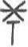

# obs-char-001050 甲骨字档案

状态：已释字候选（HUST-OBC 数据集类别，未经交叉复核） | 释读史：未收集 | 例句：0 | 更新：2026-11-02

## 1 字形与观察

- 图 1：HUST-OBC 已释字第 1177 类的一张样本，35 × 59 像素〔来源 src-hust-obc `HUST-OBC/deciphered/1177/L_1177_1079.jpg`〕。
- 观察：较淡灰色星状交叉笔连接短下行笔干；图像对比度较低。

## 2 隶定与今字候选

- HUST-OBC 官方对照表给本类的字是“祡”（U+7961）。这是数据集标注，不是本项目复核过的释读〔来源 src-hust-obc `HUST-OBC/deciphered/ID_to_chinese.json`〕。
- OBIMD 主字表中没有隶定为同一字的字形。
- EvoBC 有 1 个类别标为同一字（evobc-evo-cat-05994），可用于跨时期字形比较〔来源 src-evobc〕。
- 更正：本档案 2026-11-02 合并时曾写作“㢏”。那是早期流程把本类号错接到 HUST-OBC OCR 字表的结果，已按官方对照表更正。
## 10 来源与权利

- 来源 src-hust-obc，图片资产 `asset-001055`，权利状态 `source_marked_risk_noted`。HUST-OBC 的 Figshare 与期刊页面许可表述不一致，详见来源档案 `corpus/006_research-sources-and-bibliography/001_source-objects/015_src-hust-obc_source-object/`。
- 图片 SHA-256：`7753148507e1acb434a5c2e46b5f2ceabb41ff56c8cf14855b5cf258b0cac8b8`；来源包 `large-src-000001`。

## 11 待查项

- 在小学堂甲骨文字编中查找字头“祡”，核对字形是否与本类样本一致，记录释读、提出者和出处。
