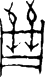

# obs-char-001087 甲骨字档案

状态：已释字候选（HUST-OBC 数据集类别，未经交叉复核） | 释读史：未收集 | 例句：0 | 更新：2026-11-02

## 1 字形与观察

- 图 1：HUST-OBC 已释字第 1216 类的一张样本，47 × 79 像素〔来源 src-hust-obc `HUST-OBC/deciphered/1216/G_1216_前5.10.1(甲).png`〕。
- 观察：紧密直立笔群有棱角上部外伸、小型中央闭合带和两条尖状下部笔。

## 2 隶定与今字候选

- HUST-OBC 给本类的标签是“㢶”（U+38B6）。这是数据集标签，不是经复核的释读〔来源 src-hust-obc Validation_label.json〕。
- 按码位对照，EvoBC 中有相同码位的条目〔来源 corpus/001 登记表 011〕。

## 8 实物与出土（著录线索）

样本文件名 `G_1216_前5.10.1(甲).png` 带有著录线索。以下只是文件名解析结果，尚未在著录中核对：

- 旧著录：前5.10.1。简称“前”在小学堂《合集材料来源表》附录中对应《殷墟書契前編》；HUST 文件名是否沿用同一体例尚未核实〔来源 src-xiaoxuetang-obm〕。
- 组类或附注（文件名原文）：(甲)

## 10 来源与权利

- 来源 src-hust-obc，图片资产 `asset-001092`，权利状态 `source_marked_risk_noted`。HUST-OBC 的 Figshare 与期刊页面许可表述不一致，详见来源档案 `corpus/006_research-sources-and-bibliography/001_source-objects/015_src-hust-obc_source-object/`。
- 图片 SHA-256：`6812379a6ecc136d504632cb052b31cac420b7be58f1aff97f70aff4d85352cb`；来源包 `large-src-000001`。

## 11 待查项

- 核对旧著录“前5.10.1”的原拓，确认简称所指的书目，以及它与合集号的对应。
- 在小学堂甲骨文字编中查找与数据集标签“㢶”对应的字头，记录释读、提出者和出处。
