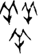

# obs-char-001128 甲骨字档案

状态：已释字候选（HUST-OBC 数据集类别，未经交叉复核） | 释读史：未收集 | 例句：0 | 更新：2026-11-02

## 1 字形与观察

- 图 1：HUST-OBC 已释字第 1259 类的一张样本，57 × 80 像素〔来源 src-hust-obc `HUST-OBC/deciphered/1259/G_1259_七S127合7006.png`〕。
- 观察：可见三个分离的棱角笔群，其中有两个上部形体和一个较小的尖状下部形体。

## 2 隶定与今字候选

- HUST-OBC 给本类的标签是“㣡”（U+38E1）。这是数据集标签，不是经复核的释读〔来源 src-hust-obc Validation_label.json〕。
- 按码位对照，OBIMD 与 EvoBC 中都没有相同码位的条目〔来源 corpus/001 登记表 011〕。

## 8 实物与出土（著录线索）

样本文件名 `G_1259_七S127合7006.png` 带有著录线索。以下只是文件名解析结果，尚未在著录中核对：

- 合集号：合7006
- 旧著录：七S127。简称“七S”未在小学堂附录简称表中找到。

## 10 来源与权利

- 来源 src-hust-obc，图片资产 `asset-001133`，权利状态 `source_marked_risk_noted`。HUST-OBC 的 Figshare 与期刊页面许可表述不一致，详见来源档案 `corpus/006_research-sources-and-bibliography/001_source-objects/015_src-hust-obc_source-object/`。
- 图片 SHA-256：`86b323ae3e2ba8cdb594a8758e16e255713816032b0d6635ef4fede9e14a4372`；来源包 `large-src-000001`。

## 11 待查项

- 在《甲骨文合集》7006 号（文件名写作“合7006”）上找到本字例，抄录所在卜辞全文并标出字位。
- 核对旧著录“七S127”的原拓，确认简称所指的书目，以及它与合集号的对应。
- 在小学堂甲骨文字编中查找与数据集标签“㣡”对应的字头，记录释读、提出者和出处。
