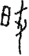

# obs-char-001153 甲骨字档案

状态：已释字候选（HUST-OBC 数据集类别，未经交叉复核） | 释读史：未收集 | 例句：2 | 更新：2026-11-02

## 1 字形与观察

- 图 1：HUST-OBC 已释字第 1290_1291_1292 类的一张样本，42 × 80 像素〔来源 src-hust-obc `HUST-OBC/deciphered/1290_1291_1292/1290/G_1290_合21623子組.png`〕。
- 该类别由 3 个来源子类合并而成〔来源 src-hust-obc Validation_label.json〕。
- 观察：较淡的狭长形体有左侧小型闭合环、中央分枝笔和右侧长下行笔。

## 2 隶定与今字候选

- HUST-OBC 官方对照表给本类的字是“肇”（U+8087）、“肈”（U+8088）、“肁”（U+8081）。这是数据集标注，不是本项目复核过的释读〔来源 src-hust-obc `HUST-OBC/deciphered/ID_to_chinese.json`〕。
- OBIMD 主字表中有 1 个字形被隶定为同一字（UID：4nm99xtfab），可据此查找卜辞字例〔来源 src-obimd 主字表〕。
- EvoBC 有 3 个类别标为同一字（evobc-evo-cat-06969、evobc-evo-cat-06974、evobc-evo-cat-06975），可用于跨时期字形比较〔来源 src-evobc〕。
- 更正：本档案 2026-11-02 合并时曾写作“㤀㤁㤂”。那是早期流程把本类号错接到 HUST-OBC OCR 字表的结果，已按官方对照表更正。

## 4 卜辞例句

以下例句取自 OBIMD 标注，按其阅读顺序排列；□ 为未识别或残缺字，◇ 为 OBIMD 自造字。片号 H 后的数字推定为《合集》号，尚待逐片核对（见案件 `case-h2-heji2`）。

| OBIMD 片号 | 释文（OBIMD） | 本字位置 | 来源 |
| --- | --- | --- | --- |
| H8 | □卜貞肇丁帝十牢 | 第 4/8 字 | src-obimd H8 句组 2 |
| H3130 | 癸酉卜賓貞乎雝肇師鮏 | 第 8/10 字 | src-obimd H3130 句组 1 |

- 其他字例所在甲骨：H3077、H5827、H6675、H7762、H12860、H14823、H15516、H15521、H15522、H15523等〔来源 src-obimd〕。

## 5 分布

- OBIMD 中共 34 个字例，见于 25 片甲骨；按句组类别：卜辞句 34〔来源 src-obimd，统计表 `corpus/002_oracle-bone-inscriptions/010_inscription-texts/002_obimd-glyph-occurrence-stats.csv`〕。
- 同一句组中最常一起出现的字：卜（17）、丁（15）、用（13）、巳（12）、叀（10）、貞（6）。
- OBIMD 没有分期和组类字段，分期分布尚待《合集》分期表或小学堂材料来源表补入。

## 8 实物与出土（著录线索）

样本文件名 `G_1290_合21623子組.png` 带有著录线索。以下只是文件名解析结果，尚未在著录中核对：

- 合集号：合21623
- 组类或附注（文件名原文）：子組

## 10 来源与权利

- 来源 src-hust-obc，图片资产 `asset-001158`，权利状态 `source_marked_risk_noted`。HUST-OBC 的 Figshare 与期刊页面许可表述不一致，详见来源档案 `corpus/006_research-sources-and-bibliography/001_source-objects/015_src-hust-obc_source-object/`。
- 图片 SHA-256：`cd91d4580dd9d2d6426bae9dcb0322428fdd3671d8c5d33b9104f78ba2a885d9`；来源包 `large-src-000001`。

## 11 待查项

- 在拓片上核对例句中本字的写法是否与本档案字形图一致；OBIMD 把它们隶定为同一字，不等于字形相同。
- 在《甲骨文合集》21623 号（文件名写作“合21623”）上找到本字例，抄录所在卜辞全文并标出字位。
- 在小学堂甲骨文字编中查找字头“肇肈肁”，核对字形是否与本类样本一致，记录释读、提出者和出处。
