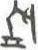

# obs-char-001187 甲骨字档案

状态：已释字候选（HUST-OBC 数据集类别，未经交叉复核） | 释读史：未收集 | 例句：0 | 更新：2026-11-02

## 1 字形与观察

- 图 1：HUST-OBC 已释字第 1327_1328 类的一张样本，38 × 50 像素〔来源 src-hust-obc `HUST-OBC/deciphered/1327_1328/1327/L_1327_4931.jpg`〕。
- 该类别由 2 个来源子类合并而成〔来源 src-hust-obc Validation_label.json〕。
- 观察：较淡的紧凑图像显示短横底笔上方的两个狭长直立形体，并有小型上部分枝。

## 2 隶定与今字候选

- HUST-OBC 官方对照表给本类的字是“航”（U+822A）、“斻”（U+65BB）。这是数据集标注，不是本项目复核过的释读〔来源 src-hust-obc `HUST-OBC/deciphered/ID_to_chinese.json`〕。
- OBIMD 主字表中没有隶定为同一字的字形。
- EvoBC 有 2 个类别标为同一字（evobc-evo-cat-03658、evobc-evo-cat-07200），可用于跨时期字形比较〔来源 src-evobc〕。
- 更正：本档案 2026-11-02 合并时曾写作“㤥㤦”。那是早期流程把本类号错接到 HUST-OBC OCR 字表的结果，已按官方对照表更正。

## 10 来源与权利

- 来源 src-hust-obc，图片资产 `asset-001192`，权利状态 `source_marked_risk_noted`。HUST-OBC 的 Figshare 与期刊页面许可表述不一致，详见来源档案 `corpus/006_research-sources-and-bibliography/001_source-objects/015_src-hust-obc_source-object/`。
- 图片 SHA-256：`368a943d49f70f7fea1d622602ae7f29d26f42d11950be9817b6d24399fb5b8a`；来源包 `large-src-000001`。

## 11 待查项

- 在小学堂甲骨文字编中查找字头“航斻”，核对字形是否与本类样本一致，记录释读、提出者和出处。
