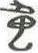

# obs-char-001230 甲骨字档案

状态：已释字候选（HUST-OBC 数据集类别，未经交叉复核） | 释读史：未收集 | 例句：0 | 更新：2026-11-02

## 1 字形与观察

- 图 1：HUST-OBC 已释字第 1376 类的一张样本，38 × 53 像素〔来源 src-hust-obc `HUST-OBC/deciphered/1376/L_1376_13164.jpg`〕。
- 观察：较淡的狭长形体有短上部交叉、中央弯笔和钩状下部转折。

## 2 隶定与今字候选

- HUST-OBC 给本类的标签是“㥖”（U+3956）。这是数据集标签，不是经复核的释读〔来源 src-hust-obc Validation_label.json〕。
- 按码位对照，OBIMD 与 EvoBC 中都没有相同码位的条目〔来源 corpus/001 登记表 011〕。

## 10 来源与权利

- 来源 src-hust-obc，图片资产 `asset-001235`，权利状态 `source_marked_risk_noted`。HUST-OBC 的 Figshare 与期刊页面许可表述不一致，详见来源档案 `corpus/006_research-sources-and-bibliography/001_source-objects/015_src-hust-obc_source-object/`。
- 图片 SHA-256：`4bd2c2524acaa84a50dc275250f5e500049a9309d2450b283d88eae1d51a2aa6`；来源包 `large-src-000001`。

## 11 待查项

- 在小学堂甲骨文字编中查找与数据集标签“㥖”对应的字头，记录释读、提出者和出处。
