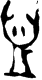

# obs-char-001237 甲骨字档案

状态：已释字候选（HUST-OBC 数据集类别，未经交叉复核） | 释读史：未收集 | 例句：0 | 更新：2026-11-02

## 1 字形与观察

- 图 1：HUST-OBC 已释字第 1384 类的一张样本，42 × 80 像素〔来源 src-hust-obc `HUST-OBC/deciphered/1384/G_1384_京都1272合24944.png`〕。
- 观察：紧凑圆弧形体有数条短上部尖枝、中央开放环和短下部底笔。

## 2 隶定与今字候选

- HUST-OBC 官方对照表给本类的字是“血”（U+8840）。这是数据集标注，不是本项目复核过的释读〔来源 src-hust-obc `HUST-OBC/deciphered/ID_to_chinese.json`〕。
- OBIMD 主字表中没有隶定为同一字的字形。
- EvoBC 有 1 个类别标为同一字（evobc-evo-cat-07895），可用于跨时期字形比较〔来源 src-evobc〕。
- 更正：本档案 2026-11-02 合并时曾写作“㥞”。那是早期流程把本类号错接到 HUST-OBC OCR 字表的结果，已按官方对照表更正。

## 8 实物与出土（著录线索）

样本文件名 `G_1384_京都1272合24944.png` 带有著录线索。以下只是文件名解析结果，尚未在著录中核对：

- 合集号：合24944
- 旧著录：京都1272。简称“京都”在小学堂《合集材料来源表》附录中对应《京都大學人文科學研究所藏甲骨文字》；HUST 文件名是否沿用同一体例尚未核实〔来源 src-xiaoxuetang-obm〕。

## 10 来源与权利

- 来源 src-hust-obc，图片资产 `asset-001242`，权利状态 `source_marked_risk_noted`。HUST-OBC 的 Figshare 与期刊页面许可表述不一致，详见来源档案 `corpus/006_research-sources-and-bibliography/001_source-objects/015_src-hust-obc_source-object/`。
- 图片 SHA-256：`f2a70ad0fc89137a5b7f3c70ce63e8e2c20c7797f128a8ff0749948068edaff1`；来源包 `large-src-000001`。

## 11 待查项

- 在《甲骨文合集》24944 号（文件名写作“合24944”）上找到本字例，抄录所在卜辞全文并标出字位。
- 核对旧著录“京都1272”的原拓，确认简称所指的书目，以及它与合集号的对应。
- 在小学堂甲骨文字编中查找字头“血”，核对字形是否与本类样本一致，记录释读、提出者和出处。
