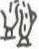

# obs-char-001295 甲骨字档案

状态：已释字候选（HUST-OBC 数据集类别，未经交叉复核） | 释读史：未收集 | 例句：2 | 更新：2026-11-02

## 1 字形与观察

- 图 1：HUST-OBC 已释字第 1448 类的一张样本，39 × 49 像素〔来源 src-hust-obc `HUST-OBC/deciphered/1448/L_1448_10827.jpg`〕。
- 观察：小型低对比度笔画群结合数条直立弧笔和短下部基线，边缘辨识度有限。

## 2 隶定与今字候选

- HUST-OBC 官方对照表给本类的字是“賜”（U+8CDC）。这是数据集标注，不是本项目复核过的释读〔来源 src-hust-obc `HUST-OBC/deciphered/ID_to_chinese.json`〕。
- OBIMD 主字表中有 1 个字形被隶定为同一字（UID：9n8ef83n5l），可据此查找卜辞字例〔来源 src-obimd 主字表〕。
- EvoBC 有 1 个类别标为同一字（evobc-evo-cat-08578），可用于跨时期字形比较〔来源 src-evobc〕。
- 更正：本档案 2026-11-02 合并时曾写作“㦞”。那是早期流程把本类号错接到 HUST-OBC OCR 字表的结果，已按官方对照表更正。

## 4 卜辞例句

以下例句取自 OBIMD 标注，按其阅读顺序排列；□ 为未识别或残缺字，◇ 为 OBIMD 自造字。片号 H 后的数字推定为《合集》号，尚待逐片核对（见案件 `case-h2-heji2`）。

| OBIMD 片号 | 释文（OBIMD） | 本字位置 | 来源 |
| --- | --- | --- | --- |
| H677 | □易多◇女 | 第 2/5 字 | src-obimd H677 句组 1 |
| H1210 | 翌庚矢易日 | 第 4/5 字 | src-obimd H1210 句组 2 |

- 其他字例所在甲骨：H1304、H1405、H1407、H2874、H3823、H5225、H5393、H7371、H7939、H12969等〔来源 src-obimd〕。

## 5 分布

- OBIMD 中共 166 个字例，见于 137 片甲骨；按句组类别：卜辞句 166〔来源 src-obimd，统计表 `corpus/002_oracle-bone-inscriptions/010_inscription-texts/002_obimd-glyph-occurrence-stats.csv`〕。
- 同一句组中最常一起出现的字：日（130）、不（68）、翌（66）、貞（54）、其（52）、卜（35）。
- OBIMD 没有分期和组类字段，分期分布尚待《合集》分期表或小学堂材料来源表补入。

## 10 来源与权利

- 来源 src-hust-obc，图片资产 `asset-001300`，权利状态 `source_marked_risk_noted`。HUST-OBC 的 Figshare 与期刊页面许可表述不一致，详见来源档案 `corpus/006_research-sources-and-bibliography/001_source-objects/015_src-hust-obc_source-object/`。
- 图片 SHA-256：`f92325ed7e80cb3a2e1348144cb909b903f0df4e1108118096f25fc6ac3ad5db`；来源包 `large-src-000001`。

## 11 待查项

- 在拓片上核对例句中本字的写法是否与本档案字形图一致；OBIMD 把它们隶定为同一字，不等于字形相同。
- 在小学堂甲骨文字编中查找字头“賜”，核对字形是否与本类样本一致，记录释读、提出者和出处。
