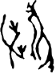

# obs-char-001392 甲骨字档案

状态：已释字候选（HUST-OBC 数据集类别，未经交叉复核） | 释读史：未收集 | 例句：0 | 更新：2026-11-02

## 1 字形与观察

- 图 1：HUST-OBC 已释字第 1557 类的一张样本，70 × 92 像素〔来源 src-hust-obc `HUST-OBC/deciphered/1557/G_1557_甲骨文0.png`〕。
- 观察：两个分离分枝形体组合为开放左分叉和长右弧线。

## 2 隶定与今字候选

- HUST-OBC 官方对照表给本类的字是“雛”（U+96DB）。这是数据集标注，不是本项目复核过的释读〔来源 src-hust-obc `HUST-OBC/deciphered/ID_to_chinese.json`〕。
- OBIMD 主字表中没有隶定为同一字的字形。
- EvoBC 有 1 个类别标为同一字（evobc-evo-cat-09824），可用于跨时期字形比较〔来源 src-evobc〕。
- 更正：本档案 2026-11-02 合并时曾写作“㨋”。那是早期流程把本类号错接到 HUST-OBC OCR 字表的结果，已按官方对照表更正。

## 10 来源与权利

- 来源 src-hust-obc，图片资产 `asset-001397`，权利状态 `source_marked_risk_noted`。HUST-OBC 的 Figshare 与期刊页面许可表述不一致，详见来源档案 `corpus/006_research-sources-and-bibliography/001_source-objects/015_src-hust-obc_source-object/`。
- 图片 SHA-256：`3f9c1bfcb23b463e47c974e4053ae6a3bb8d9bbc7c069c36eaf6105748f73ca1`；来源包 `large-src-000001`。

## 11 待查项

- 在小学堂甲骨文字编中查找字头“雛”，核对字形是否与本类样本一致，记录释读、提出者和出处。
