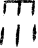

# obs-char-001396 甲骨字档案

状态：已释字候选（HUST-OBC 数据集类别，未经交叉复核） | 释读史：未收集 | 例句：2 | 更新：2026-11-02

## 1 字形与观察

- 图 1：HUST-OBC 已释字第 1561 类的一张样本，63 × 80 像素〔来源 src-hust-obc `HUST-OBC/deciphered/1561/G_1561_乙7285合14542.png`〕。
- 观察：两个短上部横笔位于数条分离直下笔之上。

## 2 隶定与今字候选

- HUST-OBC 官方对照表给本类的字是“雨”（U+96E8）。这是数据集标注，不是本项目复核过的释读〔来源 src-hust-obc `HUST-OBC/deciphered/ID_to_chinese.json`〕。
- OBIMD 主字表中有 1 个字形被隶定为同一字（UID：ftj0qy2f7b），可据此查找卜辞字例〔来源 src-obimd 主字表〕。
- EvoBC 有 1 个类别标为同一字（evobc-evo-cat-09834），可用于跨时期字形比较〔来源 src-evobc〕。
- 更正：本档案 2026-11-02 合并时曾写作“㨏”。那是早期流程把本类号错接到 HUST-OBC OCR 字表的结果，已按官方对照表更正。

## 4 卜辞例句

以下例句取自 OBIMD 标注，按其阅读顺序排列；□ 为未识别或残缺字，◇ 为 OBIMD 自造字。片号 H 后的数字推定为《合集》号，尚待逐片核对（见案件 `case-h2-heji2`）。

| OBIMD 片号 | 释文（OBIMD） | 本字位置 | 来源 |
| --- | --- | --- | --- |
| H156 | 貞翌甲寅不雨 | 第 6/6 字 | src-obimd H156 句组 4 |
| H156 | 貞翌甲寅其雨 | 第 6/6 字 | src-obimd H156 句组 6 |

- 其他字例所在甲骨：H281、H511、H982、H1007、H1008、H1764、H1972、H2612、H2837、H2944等〔来源 src-obimd〕。

## 5 分布

- OBIMD 中共 1384 个字例，见于 1065 片甲骨；按句组类别：卜辞句 1379，未定 5〔来源 src-obimd，统计表 `corpus/002_oracle-bone-inscriptions/010_inscription-texts/002_obimd-glyph-occurrence-stats.csv`〕。
- 同一句组中最常一起出现的字：貞（471）、不（399）、其（377）、今（348）、卜（292）、月（226）。
- OBIMD 没有分期和组类字段，分期分布尚待《合集》分期表或小学堂材料来源表补入。

## 8 实物与出土（著录线索）

样本文件名 `G_1561_乙7285合14542.png` 带有著录线索。以下只是文件名解析结果，尚未在著录中核对：

- 合集号：合14542
- 旧著录：乙7285。简称“乙”未在小学堂附录简称表中找到。

## 10 来源与权利

- 来源 src-hust-obc，图片资产 `asset-001401`，权利状态 `source_marked_risk_noted`。HUST-OBC 的 Figshare 与期刊页面许可表述不一致，详见来源档案 `corpus/006_research-sources-and-bibliography/001_source-objects/015_src-hust-obc_source-object/`。
- 图片 SHA-256：`ef387c1a46d49cebf4c84271f37a7ed0eaca03ea9a51edb702728b1ac5993712`；来源包 `large-src-000001`。

## 11 待查项

- 在拓片上核对例句中本字的写法是否与本档案字形图一致；OBIMD 把它们隶定为同一字，不等于字形相同。
- 在《甲骨文合集》14542 号（文件名写作“合14542”）上找到本字例，抄录所在卜辞全文并标出字位。
- 核对旧著录“乙7285”的原拓，确认简称所指的书目，以及它与合集号的对应。
- 在小学堂甲骨文字编中查找字头“雨”，核对字形是否与本类样本一致，记录释读、提出者和出处。
