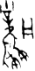

# obs-char-001420 甲骨字档案

状态：已释字候选（HUST-OBC 数据集类别，未经交叉复核） | 释读史：未收集 | 例句：2 | 更新：2026-11-02

## 1 字形与观察

- 图 1：HUST-OBC 已释字第 1589_1590_1591 类的一张样本，40 × 80 像素〔来源 src-hust-obc `HUST-OBC/deciphered/1589_1590_1591/1589/G_1589_前2.30.6(甲).png`〕。
- 该类别由 3 个来源子类合并而成〔来源 src-hust-obc Validation_label.json〕。
- 观察：微小密集组合形体有狭长左侧群、右侧框形和下部分枝。

## 2 隶定与今字候选

- HUST-OBC 官方对照表给本类的字是“風”（U+98A8）、“鳳”（U+9CF3）、“鳯”（U+9CEF）。这是数据集标注，不是本项目复核过的释读〔来源 src-hust-obc `HUST-OBC/deciphered/ID_to_chinese.json`〕。
- OBIMD 主字表中有 1 个字形被隶定为同一字（UID：x0wt5y5bs2），可据此查找卜辞字例〔来源 src-obimd 主字表〕。
- EvoBC 有 3 个类别标为同一字（evobc-evo-cat-10065、evobc-evo-cat-10473、evobc-evo-cat-10474），可用于跨时期字形比较〔来源 src-evobc〕。
- 更正：本档案 2026-11-02 合并时曾写作“㨫㨬㨭”。那是早期流程把本类号错接到 HUST-OBC OCR 字表的结果，已按官方对照表更正。

## 4 卜辞例句

以下例句取自 OBIMD 标注，按其阅读顺序排列；□ 为未识别或残缺字，◇ 为 OBIMD 自造字。片号 H 后的数字推定为《合集》号，尚待逐片核对（见案件 `case-h2-heji2`）。

| OBIMD 片号 | 释文（OBIMD） | 本字位置 | 来源 |
| --- | --- | --- | --- |
| H5373 | 癸酉卜爭貞王風不□亡延 | 第 7/11 字 | src-obimd H5373 句组 1 |
| H7371 | □其立中亡風□亡風易日 | 第 6/11 字 | src-obimd H7371 句组 1 |

- 其他字例所在甲骨：H5659、H10131、H10372、H10743、H13334、H13337、H13339、H13340、H13343、H13344等〔来源 src-obimd〕。

## 5 分布

- OBIMD 中共 83 个字例，见于 63 片甲骨；按句组类别：卜辞句 83〔来源 src-obimd，统计表 `corpus/002_oracle-bone-inscriptions/010_inscription-texts/002_obimd-glyph-occurrence-stats.csv`〕。
- 同一句组中最常一起出现的字：其（20）、卜（18）、大（18）、不（17）、日（15）、貞（14）。
- OBIMD 没有分期和组类字段，分期分布尚待《合集》分期表或小学堂材料来源表补入。

## 8 实物与出土（著录线索）

样本文件名 `G_1589_前2.30.6(甲).png` 带有著录线索。以下只是文件名解析结果，尚未在著录中核对：

- 旧著录：前2.30.6。简称“前”在小学堂《合集材料来源表》附录中对应《殷墟書契前編》；HUST 文件名是否沿用同一体例尚未核实〔来源 src-xiaoxuetang-obm〕。
- 组类或附注（文件名原文）：(甲)

## 10 来源与权利

- 来源 src-hust-obc，图片资产 `asset-001425`，权利状态 `source_marked_risk_noted`。HUST-OBC 的 Figshare 与期刊页面许可表述不一致，详见来源档案 `corpus/006_research-sources-and-bibliography/001_source-objects/015_src-hust-obc_source-object/`。
- 图片 SHA-256：`c844d01491f001a6ae0a30e99533a19f70cc610008742efb4b1efaf99daf6866`；来源包 `large-src-000001`。

## 11 待查项

- 在拓片上核对例句中本字的写法是否与本档案字形图一致；OBIMD 把它们隶定为同一字，不等于字形相同。
- 核对旧著录“前2.30.6”的原拓，确认简称所指的书目，以及它与合集号的对应。
- 在小学堂甲骨文字编中查找字头“風鳳鳯”，核对字形是否与本类样本一致，记录释读、提出者和出处。
