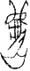

# obs-char-001500 甲骨字档案

状态：已释字候选（HUST-OBC 数据集类别，未经交叉复核） | 释读史：未收集 | 例句：0 | 更新：2026-11-02

## 1 字形与观察

- 图 1：HUST-OBC 已释字第 1682_1683_1684 类的一张样本，34 × 80 像素〔来源 src-hust-obc `HUST-OBC/deciphered/1682_1683_1684/1683/G_1683_乙4741(甲).png`〕。
- 该类别由 3 个来源子类合并而成〔来源 src-hust-obc Validation_label.json〕。
- 观察：浅淡紧凑笔画群有上部分叉、狭长主体和下部弧线。

## 2 隶定与今字候选

- HUST-OBC 官方对照表给本类的字是“龝”（U+9F9D）、“秋”（U+79CB）、“𬟏”（U+2C7CF）。这是数据集标注，不是本项目复核过的释读〔来源 src-hust-obc `HUST-OBC/deciphered/ID_to_chinese.json`〕。
- OBIMD 主字表中有 2 个字形被隶定为同一字（UID：4qrbm22mmt、bey28jrhwu），可据此查找卜辞字例〔来源 src-obimd 主字表〕。
- EvoBC 有 3 个类别标为同一字（evobc-evo-cat-06057、evobc-evo-cat-10755、evobc-evo-cat-13313），可用于跨时期字形比较〔来源 src-evobc〕。
- 更正：本档案 2026-11-02 合并时曾写作“㪈㪉㪊”。那是早期流程把本类号错接到 HUST-OBC OCR 字表的结果，已按官方对照表更正。
## 8 实物与出土（著录线索）

样本文件名 `G_1683_乙4741(甲).png` 带有著录线索。以下只是文件名解析结果，尚未在著录中核对：

- 旧著录：乙4741。简称“乙”未在小学堂附录简称表中找到。
- 组类或附注（文件名原文）：(甲)

## 10 来源与权利

- 来源 src-hust-obc，图片资产 `asset-001505`，权利状态 `source_marked_risk_noted`。HUST-OBC 的 Figshare 与期刊页面许可表述不一致，详见来源档案 `corpus/006_research-sources-and-bibliography/001_source-objects/015_src-hust-obc_source-object/`。
- 图片 SHA-256：`6ef503ffdef22e75527844558e173755de37578232d01cd39cb7c95eb200081a`；来源包 `large-src-000001`。

## 11 待查项

- 从 OBIMD 卜辞语料中取出这些 UID 的全部字例，抄录带著录号的例句，统计分期与共现字。
- 核对旧著录“乙4741”的原拓，确认简称所指的书目，以及它与合集号的对应。
- 在小学堂甲骨文字编中查找字头“龝秋𬟏”，核对字形是否与本类样本一致，记录释读、提出者和出处。
