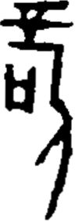

# obs-char-001520 甲骨字档案

状态：已释字候选（HUST-OBC 数据集类别，未经交叉复核） | 释读史：未收集 | 例句：2 | 更新：2026-11-02

## 1 字形与观察

- 图 1：HUST-OBC 已释字第 1705_1706 类的一张样本，96 × 282 像素〔来源 src-hust-obc `HUST-OBC/deciphered/1705_1706/1705/X_1705_472_1.png`〕。
- 该类别由 2 个来源子类合并而成〔来源 src-hust-obc Validation_label.json〕。
- 观察：高大组合形体有层叠上横笔、左侧小框形和长斜向下部笔画。

## 2 隶定与今字候选

- HUST-OBC 官方对照表给本类的字是“𠱫”（U+20C6B）、“𥩮”（U+25A6E）。这是数据集标注，不是本项目复核过的释读〔来源 src-hust-obc `HUST-OBC/deciphered/ID_to_chinese.json`〕。
- OBIMD 主字表中有 1 个字形被隶定为同一字（UID：aamr2zeydd），可据此查找卜辞字例〔来源 src-obimd 主字表〕。
- EvoBC 有 2 个类别标为同一字（evobc-evo-cat-10936、evobc-evo-cat-11858），可用于跨时期字形比较〔来源 src-evobc〕。
- 更正：本档案 2026-11-02 合并时曾写作“㪟㪠”。那是早期流程把本类号错接到 HUST-OBC OCR 字表的结果，已按官方对照表更正。

## 4 卜辞例句

以下例句取自 OBIMD 标注，按其阅读顺序排列；□ 为未识别或残缺字，◇ 为 OBIMD 自造字。片号 H 后的数字推定为《合集》号，尚待逐片核对（见案件 `case-h2-heji2`）。

| OBIMD 片号 | 释文（OBIMD） | 本字位置 | 来源 |
| --- | --- | --- | --- |
| H1956 | 癸卯卜賓貞告王𠱫于丁 | 第 8/10 字 | src-obimd H1956 句组 1 |
| H3089 | 辛丑卜賓貞叀令◇甗𠱫◇◇ | 第 10/12 字 | src-obimd H3089 句组 1 |

- 其他字例所在甲骨：H5606、H5623、H15881、H17106、H17340〔来源 src-obimd〕。

## 5 分布

- OBIMD 中共 7 个字例，见于 7 片甲骨；按句组类别：卜辞句 7〔来源 src-obimd，统计表 `corpus/002_oracle-bone-inscriptions/010_inscription-texts/002_obimd-glyph-occurrence-stats.csv`〕。
- 同一句组中最常一起出现的字：貞（6）、令（5）、卜（4）、于（3）、賓（3）、卯（2）。
- OBIMD 没有分期和组类字段，分期分布尚待《合集》分期表或小学堂材料来源表补入。

## 10 来源与权利

- 来源 src-hust-obc，图片资产 `asset-001525`，权利状态 `source_marked_risk_noted`。HUST-OBC 的 Figshare 与期刊页面许可表述不一致，详见来源档案 `corpus/006_research-sources-and-bibliography/001_source-objects/015_src-hust-obc_source-object/`。
- 图片 SHA-256：`954674e7475be7b766575d7d951d2170b9858eaaaa647cf3851f48b8005b8563`；来源包 `large-src-000001`。

## 11 待查项

- 在拓片上核对例句中本字的写法是否与本档案字形图一致；OBIMD 把它们隶定为同一字，不等于字形相同。
- 在小学堂甲骨文字编中查找字头“𠱫𥩮”，核对字形是否与本类样本一致，记录释读、提出者和出处。
