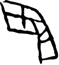

# obs-char-001577 甲骨字档案

状态：已释字候选（HUST-OBC 数据集类别，未经交叉复核） | 释读史：未收集 | 例句：0 | 更新：2026-11-02

## 1 字形与观察

- 图 1：HUST-OBC 已释字第 1769 类的一张样本，119 × 132 像素〔来源 src-hust-obc `HUST-OBC/deciphered/1769/G_1769_佚226背(甲).png`〕。
- 观察：宽大的弯折框形有分段上部笔画和矩形下部延伸。

## 2 隶定与今字候选

- HUST-OBC 官方对照表给本类的字是“𩙺”（U+2967A）。这是数据集标注，不是本项目复核过的释读〔来源 src-hust-obc `HUST-OBC/deciphered/ID_to_chinese.json`〕。
- OBIMD 主字表中没有隶定为同一字的字形。
- EvoBC 有 1 个类别标为同一字（evobc-evo-cat-12624），可用于跨时期字形比较〔来源 src-evobc〕。
- 更正：本档案 2026-11-02 合并时曾写作“㫟”。那是早期流程把本类号错接到 HUST-OBC OCR 字表的结果，已按官方对照表更正。
## 8 实物与出土（著录线索）

样本文件名 `G_1769_佚226背(甲).png` 带有著录线索。以下只是文件名解析结果，尚未在著录中核对：

- 旧著录：佚226。简称“佚”在小学堂《合集材料来源表》附录中对应《殷契佚存補編》；HUST 文件名是否沿用同一体例尚未核实〔来源 src-xiaoxuetang-obm〕。
- 组类或附注（文件名原文）：背(甲)

## 10 来源与权利

- 来源 src-hust-obc，图片资产 `asset-001582`，权利状态 `source_marked_risk_noted`。HUST-OBC 的 Figshare 与期刊页面许可表述不一致，详见来源档案 `corpus/006_research-sources-and-bibliography/001_source-objects/015_src-hust-obc_source-object/`。
- 图片 SHA-256：`575eee4140a766eda36ca81d1c2033648f68a9a161ebf6de64cf6b0947fb0e82`；来源包 `large-src-000001`。

## 11 待查项

- 核对旧著录“佚226”的原拓，确认简称所指的书目，以及它与合集号的对应。
- 在小学堂甲骨文字编中查找字头“𩙺”，核对字形是否与本类样本一致，记录释读、提出者和出处。
