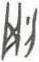

# obs-unk-001594 未释字档案

状态：未释字候选（HUST-OBC 数据集类别，未经交叉复核） | 释读史：未收集 | 例句：0 | 更新：2026-11-02

## 1 字形与观察

- 图 1：HUST-OBC 未释字 L 组第 1594 类的一张样本，39 × 62 像素〔来源 src-hust-obc `HUST-OBC/undeciphered/L/1594/L_？_14443.jpg`〕。
- 来源报告本类只有这一张样本。
- 观察：arrangement, with curved side marks and a tapered lower end.图像可见两条较高交叉笔痕形成窄长中央布局；两侧有弯曲痕，底部逐渐收窄。
- 观察：具体笔痕、残损和墨色边界仍需与原始来源核对。

## 2 隶定与今字候选

- 数据集没有给出今字标签（来源文件名中以“？”表示）。

## 10 来源与权利

- 来源 src-hust-obc，图片资产 `asset-003187`，权利状态 `source_marked_risk_noted`。HUST-OBC 的 Figshare 与期刊页面许可表述不一致，详见来源档案 `corpus/006_research-sources-and-bibliography/001_source-objects/015_src-hust-obc_source-object/`。
- 图片 SHA-256：`49d6e425f98664a722f57c5f92fe6e83cc747411d152854f00b754ed425f2fb8`；来源包 `large-src-000001`。

## 11 待查项

- 本类只有这一张样本，是孤例；在原拓或著录中找到它的出处后才能讨论释读。
- 在殷契文渊或小学堂字形库中检索近形字，记录比较结果与出处。
