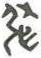

# obs-unk-001931 未释字档案

状态：未释字候选（HUST-OBC 数据集类别，未经交叉复核） | 释读史：未收集 | 例句：0 | 更新：2026-11-02

## 1 字形与观察

- 图 1：HUST-OBC 未释字 L 组第 1931 类的一张样本，41 × 58 像素〔来源 src-hust-obc `HUST-OBC/undeciphered/L/1931/L_Јї_1655.jpg`〕。
- 来源报告本类只有这一张样本。
- 观察：多条弯折和曲向笔痕从左上向右下分布。中央交叠区域上方有一条短的角状笔痕。下部可见两条曲向笔痕，各自有分离的末端；未见清楚的封闭轮廓。
- 观察：笔痕先后、交叠关系和可能的残损仍未复核。

## 2 隶定与今字候选

- 数据集没有给出今字标签（来源文件名中以“？”表示）。

## 10 来源与权利

- 来源 src-hust-obc，图片资产 `asset-003524`，权利状态 `source_marked_risk_noted`。HUST-OBC 的 Figshare 与期刊页面许可表述不一致，详见来源档案 `corpus/006_research-sources-and-bibliography/001_source-objects/015_src-hust-obc_source-object/`。
- 图片 SHA-256：`674210886eac7dc9f5fa9464980d767f8c963301fe48666d09b9b21d62fbba15`；来源包 `large-src-000001`。

## 11 待查项

- 本类只有这一张样本，是孤例；在原拓或著录中找到它的出处后才能讨论释读。
- 在殷契文渊或小学堂字形库中检索近形字，记录比较结果与出处。
