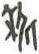

# obs-unk-001932 未释字档案

状态：未释字候选（HUST-OBC 数据集类别，未经交叉复核） | 释读史：未收集 | 例句：0 | 更新：2026-11-02

## 1 字形与观察

- 图 1：HUST-OBC 未释字 L 组第 1932 类的一张样本，39 × 54 像素〔来源 src-hust-obc `HUST-OBC/undeciphered/L/1932/L_Јї_1656.jpg`〕。
- 来源报告本类只有这一张样本。
- 观察：中央有一组由多条斜向和近竖向笔痕组成的密集墨痕。左侧有曲向笔痕向下延伸，右侧有数条较高的笔痕继续向下。下方中央附近另有小的分离斜痕，整体外缘不规则。
- 观察：密集交叠处和可能的残缺笔端需要按来源原始分辨率复核。

## 2 隶定与今字候选

- 数据集没有给出今字标签（来源文件名中以“？”表示）。

## 10 来源与权利

- 来源 src-hust-obc，图片资产 `asset-003525`，权利状态 `source_marked_risk_noted`。HUST-OBC 的 Figshare 与期刊页面许可表述不一致，详见来源档案 `corpus/006_research-sources-and-bibliography/001_source-objects/015_src-hust-obc_source-object/`。
- 图片 SHA-256：`77398c5b34c7d25b45651b8f156fabb8f61d77d276b0b2ce3f1429bd1a7c2140`；来源包 `large-src-000001`。

## 11 待查项

- 本类只有这一张样本，是孤例；在原拓或著录中找到它的出处后才能讨论释读。
- 在殷契文渊或小学堂字形库中检索近形字，记录比较结果与出处。
