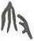

# obs-unk-003619 未释字档案

状态：未释字候选（HUST-OBC 数据集类别，未经交叉复核） | 释读史：未收集 | 例句：0 | 更新：2026-11-02

## 1 字形与观察

- 图 1：HUST-OBC 未释字 L 组第 3619 类的一张样本，43 × 52 像素〔来源 src-hust-obc `HUST-OBC/undeciphered/L/3619/L_？_731.jpg`〕。
- 来源报告本类只有这一张样本。
- 观察：The image does not establish whether the strokes share a base.简体中文：
- 观察：下部向上伸出数条窄笔画，顶部呈尖状。
- 观察：左侧和中央笔画彼此接近，视觉上有部分重叠。
- 观察：右侧另有一组斜向笔画向外伸展。
- 观察：图像不能证明这些笔画是否共用同一底部。

## 2 隶定与今字候选

- 数据集没有给出今字标签（来源文件名中以“？”表示）。

## 10 来源与权利

- 来源 src-hust-obc，图片资产 `asset-005212`，权利状态 `source_marked_risk_noted`。HUST-OBC 的 Figshare 与期刊页面许可表述不一致，详见来源档案 `corpus/006_research-sources-and-bibliography/001_source-objects/015_src-hust-obc_source-object/`。
- 图片 SHA-256：`473f70895f09e5e2a3b82b18669250dca6c8201e31f5a23bd44ff71d12a36315`；来源包 `large-src-000001`。

## 11 待查项

- 本类只有这一张样本，是孤例；在原拓或著录中找到它的出处后才能讨论释读。
- 在殷契文渊或小学堂字形库中检索近形字，记录比较结果与出处。
