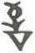

# obs-unk-003625 未释字档案

状态：未释字候选（HUST-OBC 数据集类别，未经交叉复核） | 释读史：未收集 | 例句：0 | 更新：2026-11-02

## 1 字形与观察

- 图 1：HUST-OBC 未释字 L 组第 3625 类的一张样本，35 × 53 像素〔来源 src-hust-obc `HUST-OBC/undeciphered/L/3625/L_？_7369.jpg`〕。
- 来源报告本类只有这一张样本。
- 观察：The image does not establish whether they are one connected sign.简体中文：
- 观察：数条短笔画组成的小形态位于较宽的下部 V 形轮廓之上。
- 观察：下部轮廓中有一条深色横向或略倾斜的交叉笔画。
- 观察：上下两部分在图像中大致上下对齐。
- 观察：图像不能证明它们是否属于同一个相连形态。

## 2 隶定与今字候选

- 数据集没有给出今字标签（来源文件名中以“？”表示）。

## 10 来源与权利

- 来源 src-hust-obc，图片资产 `asset-005218`，权利状态 `source_marked_risk_noted`。HUST-OBC 的 Figshare 与期刊页面许可表述不一致，详见来源档案 `corpus/006_research-sources-and-bibliography/001_source-objects/015_src-hust-obc_source-object/`。
- 图片 SHA-256：`07c3438fd354c5987189285f6073ef1f2d2dedbc5d8b436337b9dcb213d1a1d9`；来源包 `large-src-000001`。

## 11 待查项

- 本类只有这一张样本，是孤例；在原拓或著录中找到它的出处后才能讨论释读。
- 在殷契文渊或小学堂字形库中检索近形字，记录比较结果与出处。
