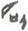

# obs-unk-003643 未释字档案

状态：未释字候选（HUST-OBC 数据集类别，未经交叉复核） | 释读史：未收集 | 例句：0 | 更新：2026-11-02

## 1 字形与观察

- 图 1：HUST-OBC 未释字 L 组第 3643 类的一张样本，41 × 45 像素〔来源 src-hust-obc `HUST-OBC/undeciphered/L/3643/L_？_7442.jpg`〕。
- 来源报告本类只有这一张样本。
- 观察：The crop does not establish whether these marks form one unit.简体中文：
- 观察：上左区域有一条较深的斜向笔画。
- 观察：中央附近可见一个小的方折或弧形形态。
- 观察：另有一条弧形笔画向右下方伸展。
- 观察：图像不能证明这些形态是否构成同一单位。

## 2 隶定与今字候选

- 数据集没有给出今字标签（来源文件名中以“？”表示）。

## 10 来源与权利

- 来源 src-hust-obc，图片资产 `asset-005236`，权利状态 `source_marked_risk_noted`。HUST-OBC 的 Figshare 与期刊页面许可表述不一致，详见来源档案 `corpus/006_research-sources-and-bibliography/001_source-objects/015_src-hust-obc_source-object/`。
- 图片 SHA-256：`1cc4643afaa29b3aeea68665297ce25f85e12a7f3c52941ac452d22abbc3a16c`；来源包 `large-src-000001`。

## 11 待查项

- 本类只有这一张样本，是孤例；在原拓或著录中找到它的出处后才能讨论释读。
- 在殷契文渊或小学堂字形库中检索近形字，记录比较结果与出处。
