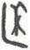

# obs-unk-003673 未释字档案

状态：未释字候选（HUST-OBC 数据集类别，未经交叉复核） | 释读史：未收集 | 例句：0 | 更新：2026-11-02

## 1 字形与观察

- 图 1：HUST-OBC 未释字 L 组第 3673 类的一张样本，34 × 56 像素〔来源 src-hust-obc `HUST-OBC/undeciphered/L/3673/L_？_753.jpg`〕。
- 来源报告本类只有这一张样本。
- 观察：The small image does not establish which upper strokes join the base.简体中文：
- 观察：一条较窄的竖向笔画构成字形左边缘。
- 观察：上右区域有折角和弯曲笔画形成的笔画群。
- 观察：一条较长的弯曲笔画横向延伸于下部。
- 观察：下部笔画末端较宽且不均匀。
- 观察：小尺寸图像无法确认上部笔画与下部基线的连接关系。

## 2 隶定与今字候选

- 数据集没有给出今字标签（来源文件名中以“？”表示）。

## 10 来源与权利

- 来源 src-hust-obc，图片资产 `asset-005266`，权利状态 `source_marked_risk_noted`。HUST-OBC 的 Figshare 与期刊页面许可表述不一致，详见来源档案 `corpus/006_research-sources-and-bibliography/001_source-objects/015_src-hust-obc_source-object/`。
- 图片 SHA-256：`ebaa01e9563642e4e1d06a5b20e2278c7a19e6bc36ad91da6242b3b0776c3a20`；来源包 `large-src-000001`。

## 11 待查项

- 本类只有这一张样本，是孤例；在原拓或著录中找到它的出处后才能讨论释读。
- 在殷契文渊或小学堂字形库中检索近形字，记录比较结果与出处。
