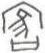

# obs-unk-003683 未释字档案

状态：未释字候选（HUST-OBC 数据集类别，未经交叉复核） | 释读史：未收集 | 例句：0 | 更新：2026-11-02

## 1 字形与观察

- 图 1：HUST-OBC 未释字 L 组第 3683 类的一张样本，45 × 53 像素〔来源 src-hust-obc `HUST-OBC/undeciphered/L/3683/L_？_7553.jpg`〕。
- 来源报告本类只有这一张样本。
- 观察：The image should be compared with nearby records before any variant claim.简体中文：
- 观察：一个尖顶外部轮廓包围中央区域。
- 观察：轮廓内部可见数条斜向笔画。
- 观察：一条较窄笔画从左侧内部向下延伸。
- 观察：一条短横向笔画构成下部边界。
- 观察：任何异体判断前，都应先与相邻记录进行图像比较。

## 2 隶定与今字候选

- 数据集没有给出今字标签（来源文件名中以“？”表示）。

## 10 来源与权利

- 来源 src-hust-obc，图片资产 `asset-005276`，权利状态 `source_marked_risk_noted`。HUST-OBC 的 Figshare 与期刊页面许可表述不一致，详见来源档案 `corpus/006_research-sources-and-bibliography/001_source-objects/015_src-hust-obc_source-object/`。
- 图片 SHA-256：`11dff71c664e7f4087d536c6cbd31be3c9d2aed616034bc51739a6381a3c7a37`；来源包 `large-src-000001`。

## 11 待查项

- 本类只有这一张样本，是孤例；在原拓或著录中找到它的出处后才能讨论释读。
- 在殷契文渊或小学堂字形库中检索近形字，记录比较结果与出处。
