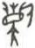

# obs-unk-004123 未释字档案

状态：未释字候选（HUST-OBC 数据集类别，未经交叉复核） | 释读史：未收集 | 例句：0 | 更新：2026-11-02

## 1 字形与观察

- 图 1：HUST-OBC 未释字 L 组第 4123 类的一张样本，40 × 54 像素〔来源 src-hust-obc `HUST-OBC/undeciphered/L/4123/L_？_8882.jpg`〕。
- 来源报告本类只有这一张样本。
- 观察：中文：数条短竖或弯曲笔画组成较宽的上部痕迹组。
- 观察：中文：中部可见深色的横向或弧向连接。
- 观察：中文：一条较窄的中央主干向下延伸到尖状端点。
- 观察：中文：左右两侧笔画连接处需用更高分辨率图像核对。

## 2 隶定与今字候选

- 数据集没有给出今字标签（来源文件名中以“？”表示）。

## 10 来源与权利

- 来源 src-hust-obc，图片资产 `asset-005716`，权利状态 `source_marked_risk_noted`。HUST-OBC 的 Figshare 与期刊页面许可表述不一致，详见来源档案 `corpus/006_research-sources-and-bibliography/001_source-objects/015_src-hust-obc_source-object/`。
- 图片 SHA-256：`e6372da51060afbb3ab6e26914e04b86c868028fc551c87590228424620fb1b1`；来源包 `large-src-000001`。

## 11 待查项

- 本类只有这一张样本，是孤例；在原拓或著录中找到它的出处后才能讨论释读。
- 在殷契文渊或小学堂字形库中检索近形字，记录比较结果与出处。
