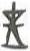

# obs-unk-004345 未释字档案

状态：未释字候选（HUST-OBC 数据集类别，未经交叉复核） | 释读史：未收集 | 例句：0 | 更新：2026-11-02

## 1 字形与观察

- 图 1：HUST-OBC 未释字 L 组第 4345 类的一张样本，30 × 51 像素〔来源 src-hust-obc `HUST-OBC/undeciphered/L/4345/L_？_9624.jpg`〕。
- 来源报告本类只有这一张样本。
- 观察：上部可见一条短斜向分支，连接在中央下行痕迹附近。
- 观察：中部有较宽的横向或斜向深色痕迹。
- 观察：下部似分开为两个短而不齐的末端。
- 观察：图像边缘模糊，未见可供判断的周围版面信息。

## 2 隶定与今字候选

- 数据集没有给出今字标签（来源文件名中以“？”表示）。

## 10 来源与权利

- 来源 src-hust-obc，图片资产 `asset-005938`，权利状态 `source_marked_risk_noted`。HUST-OBC 的 Figshare 与期刊页面许可表述不一致，详见来源档案 `corpus/006_research-sources-and-bibliography/001_source-objects/015_src-hust-obc_source-object/`。
- 图片 SHA-256：`3f56199e5fed816f68cc4ff7ccd8278545a3cd1f747eb4a633f6895756218b6d`；来源包 `large-src-000001`。

## 11 待查项

- 本类只有这一张样本，是孤例；在原拓或著录中找到它的出处后才能讨论释读。
- 在殷契文渊或小学堂字形库中检索近形字，记录比较结果与出处。
