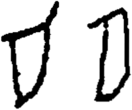

# obs-unk-004509 未释字档案

状态：未释字候选（HUST-OBC 数据集类别，未经交叉复核） | 释读史：未收集 | 例句：0 | 更新：2026-11-02

## 1 字形与观察

- 图 1：HUST-OBC 未释字 X 组第 65 类的一张样本，223 × 186 像素〔来源 src-hust-obc `HUST-OBC/undeciphered/X/65/X_？_8250_1.png`〕。
- 来源报告本类共有 2 张样本；本目录只保存其中一张。
- 观察：本地 JPG 中左右并列有两个彼此分开的形态。
- 观察：左侧形态有宽大的弧形轮廓和短的上部外伸痕。
- 观察：右侧形态轮廓较窄，上边缘带有斜向折角。
- 观察：两个形态的轮廓内部都保留浅色或开放区域。
- 观察：来源索引预期两个图像记录，但当前仅有一个本地 JPG。

## 2 隶定与今字候选

- 数据集没有给出今字标签（来源文件名中以“？”表示）。

## 10 来源与权利

- 来源 src-hust-obc，图片资产 `asset-006102`，权利状态 `source_marked_risk_noted`。HUST-OBC 的 Figshare 与期刊页面许可表述不一致，详见来源档案 `corpus/006_research-sources-and-bibliography/001_source-objects/015_src-hust-obc_source-object/`。
- 图片 SHA-256：`fddd7966ba88d052c4fc363bcc3061d3d7567a33a5e78e01510d70f0db653c79`；来源包 `large-src-000001`。

## 11 待查项

- 查看 HUST-OBC 本类其余样本（来源报告共 2 张）的文件名，确认是否带有著录号，并检查它们是否真是同一字。
- 在殷契文渊或小学堂字形库中检索近形字，记录比较结果与出处。
