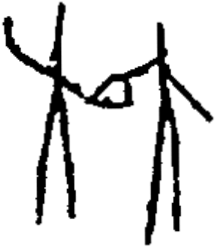

# obs-unk-004524 未释字档案

状态：未释字候选（HUST-OBC 数据集类别，未经交叉复核） | 释读史：未收集 | 例句：0 | 更新：2026-11-02

## 1 字形与观察

- 图 1：HUST-OBC 未释字 X 组第 80 类的一张样本，215 × 247 像素〔来源 src-hust-obc `HUST-OBC/undeciphered/X/80/X_？_7209_1.png`〕。
- 来源报告本类共有 3 张样本；本目录只保存其中一张。
- 观察：JPG 中有两组高的痕迹群，并由中央横带连接。
- 观察：左侧痕迹群上部弯曲，下方有两条较长的下伸痕。
- 观察：中央横带内部可见一个小型三角形空隙。
- 观察：右侧痕迹群有高的主痕、下伸痕和侧向分支。
- 观察：来源索引预期三个图像记录，但当前仅有一个本地 JPG。

## 2 隶定与今字候选

- 数据集没有给出今字标签（来源文件名中以“？”表示）。

## 10 来源与权利

- 来源 src-hust-obc，图片资产 `asset-006117`，权利状态 `source_marked_risk_noted`。HUST-OBC 的 Figshare 与期刊页面许可表述不一致，详见来源档案 `corpus/006_research-sources-and-bibliography/001_source-objects/015_src-hust-obc_source-object/`。
- 图片 SHA-256：`0443015262ebc447551f0b9b10f728dfe69cd89c99a45f5f3baea0577bdff8f0`；来源包 `large-src-000001`。

## 11 待查项

- 查看 HUST-OBC 本类其余样本（来源报告共 3 张）的文件名，确认是否带有著录号，并检查它们是否真是同一字。
- 在殷契文渊或小学堂字形库中检索近形字，记录比较结果与出处。
