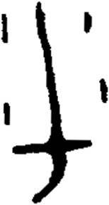

# obs-unk-004525 未释字档案

状态：未释字候选（HUST-OBC 数据集类别，未经交叉复核） | 释读史：未收集 | 例句：0 | 更新：2026-11-02

## 1 字形与观察

- 图 1：HUST-OBC 未释字 X 组第 81 类的一张样本，154 × 288 像素〔来源 src-hust-obc `HUST-OBC/undeciphered/X/81/X_？_8264_1.png`〕。
- 来源报告本类只有这一张样本。
- 观察：JPG 显示一条向下延伸的中央长痕迹，并有宽的横向底部。
- 观察：下部连接处向左伸出一条窄分支。
- 观察：连接处右下方有一条短弯曲下行痕迹。
- 观察：右上方可见一个分离的小痕迹。
- 观察：左右边缘附近还有数个细小分离痕迹。

## 2 隶定与今字候选

- 数据集没有给出今字标签（来源文件名中以“？”表示）。

## 10 来源与权利

- 来源 src-hust-obc，图片资产 `asset-006118`，权利状态 `source_marked_risk_noted`。HUST-OBC 的 Figshare 与期刊页面许可表述不一致，详见来源档案 `corpus/006_research-sources-and-bibliography/001_source-objects/015_src-hust-obc_source-object/`。
- 图片 SHA-256：`2d6155e70b1e05d44fbe8279553912551720846afa32ae294e35d1fcaf93e9d4`；来源包 `large-src-000001`。

## 11 待查项

- 本类只有这一张样本，是孤例；在原拓或著录中找到它的出处后才能讨论释读。
- 在殷契文渊或小学堂字形库中检索近形字，记录比较结果与出处。
