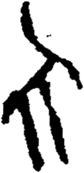

# obs-unk-004574 未释字档案

状态：未释字候选（HUST-OBC 数据集类别，未经交叉复核） | 释读史：未收集 | 例句：0 | 更新：2026-11-02

## 1 字形与观察

- 图 1：HUST-OBC 未释字 X 组第 130 类的一张样本，143 × 294 像素〔来源 src-hust-obc `HUST-OBC/undeciphered/X/130/X_？_8309_1.png`〕。
- 来源报告本类只有这一张样本。
- 观察：左上有一条向下弯曲的窄痕。
- 观察：上部痕迹经过中央连接处后向下分叉。
- 观察：下部三条痕迹分别延伸到不同的尖状或圆曲末端。
- 观察：左侧分支较短，并在末端附近向外弯曲。
- 观察：中央分支最长且方向最接近垂直。

## 2 隶定与今字候选

- 数据集没有给出今字标签（来源文件名中以“？”表示）。

## 10 来源与权利

- 来源 src-hust-obc，图片资产 `asset-006167`，权利状态 `source_marked_risk_noted`。HUST-OBC 的 Figshare 与期刊页面许可表述不一致，详见来源档案 `corpus/006_research-sources-and-bibliography/001_source-objects/015_src-hust-obc_source-object/`。
- 图片 SHA-256：`10eb73a5f919fe550f8cf249bc915e3cb0ce6a600b0072a6aef48a5d5fc4c28b`；来源包 `large-src-000001`。

## 11 待查项

- 本类只有这一张样本，是孤例；在原拓或著录中找到它的出处后才能讨论释读。
- 在殷契文渊或小学堂字形库中检索近形字，记录比较结果与出处。
