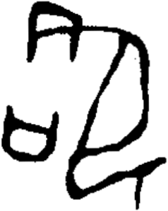

# obs-unk-004580 未释字档案

状态：未释字候选（HUST-OBC 数据集类别，未经交叉复核） | 释读史：未收集 | 例句：0 | 更新：2026-11-02

## 1 字形与观察

- 图 1：HUST-OBC 未释字 X 组第 136 类的一张样本，238 × 298 像素〔来源 src-hust-obc `HUST-OBC/undeciphered/X/136/X_？_7214_1.png`〕。
- 来源报告本类共有 2 张样本；本目录只保存其中一张。
- 观察：上部痕迹形成宽的弧形顶，并有两个向下的齿状末端。
- 观察：左下有一个小的圆曲开放环形痕迹。
- 观察：右侧形成带斜边的大型弯曲轮廓。
- 观察：右下轮廓继续形成一处钩状外伸部分。
- 观察：来源索引预期有两张图，但当前只有一张本地派生图。

## 2 隶定与今字候选

- 数据集没有给出今字标签（来源文件名中以“？”表示）。

## 10 来源与权利

- 来源 src-hust-obc，图片资产 `asset-006173`，权利状态 `source_marked_risk_noted`。HUST-OBC 的 Figshare 与期刊页面许可表述不一致，详见来源档案 `corpus/006_research-sources-and-bibliography/001_source-objects/015_src-hust-obc_source-object/`。
- 图片 SHA-256：`e2418c285cbfedea4516e7657562e000805283b00162c2efb84a51ccf5cbf9cd`；来源包 `large-src-000001`。

## 11 待查项

- 查看 HUST-OBC 本类其余样本（来源报告共 2 张）的文件名，确认是否带有著录号，并检查它们是否真是同一字。
- 在殷契文渊或小学堂字形库中检索近形字，记录比较结果与出处。
