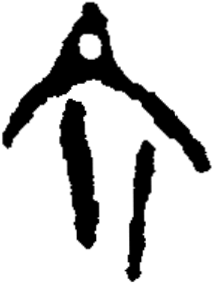

# obs-unk-004597 未释字档案

状态：未释字候选（HUST-OBC 数据集类别，未经交叉复核） | 释读史：未收集 | 例句：0 | 更新：2026-11-02

## 1 字形与观察

- 图 1：HUST-OBC 未释字 X 组第 153 类的一张样本，213 × 284 像素〔来源 src-hust-obc `HUST-OBC/undeciphered/X/153/X_？_8330_1.png`〕。
- 来源报告本类只有这一张样本。
- 观察：上部尖顶内有一个小的浅色椭圆开口。
- 观察：宽的弧形拱痕从尖顶向两侧下行。
- 观察：拱形内部悬有两条分离的长竖向痕迹。
- 观察：两条内部痕迹的下端高度不一致。
- 观察：外部拱痕在两条内部痕迹下方保持开放。

## 2 隶定与今字候选

- 数据集没有给出今字标签（来源文件名中以“？”表示）。

## 10 来源与权利

- 来源 src-hust-obc，图片资产 `asset-006190`，权利状态 `source_marked_risk_noted`。HUST-OBC 的 Figshare 与期刊页面许可表述不一致，详见来源档案 `corpus/006_research-sources-and-bibliography/001_source-objects/015_src-hust-obc_source-object/`。
- 图片 SHA-256：`5695d2e0bb4a93e4ca01ebe0a5af6d157df09692725ade6df2f046ae8afd466b`；来源包 `large-src-000001`。

## 11 待查项

- 本类只有这一张样本，是孤例；在原拓或著录中找到它的出处后才能讨论释读。
- 在殷契文渊或小学堂字形库中检索近形字，记录比较结果与出处。
