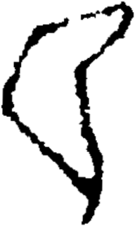

# obs-unk-004626 未释字档案

状态：未释字候选（HUST-OBC 数据集类别，未经交叉复核） | 释读史：未收集 | 例句：0 | 更新：2026-11-02

## 1 字形与观察

- 图 1：HUST-OBC 未释字 X 组第 182 类的一张样本，192 × 321 像素〔来源 src-hust-obc `HUST-OBC/undeciphered/X/182/X_？_8356_1.png`〕。
- 来源报告本类只有这一张样本。
- 观察：一条宽大的开放轮廓从左上方向右上方弯曲延伸。
- 观察：右上端收窄为尖状、略向上的末端。
- 观察：左侧沿一条较长且不规则的弧线向下延伸。
- 观察：右侧先向内弯曲，再向下延伸至下部尖端。
- 观察：两条深色轮廓之间保留一片较宽的浅色区域。

## 2 隶定与今字候选

- 数据集没有给出今字标签（来源文件名中以“？”表示）。

## 10 来源与权利

- 来源 src-hust-obc，图片资产 `asset-006219`，权利状态 `source_marked_risk_noted`。HUST-OBC 的 Figshare 与期刊页面许可表述不一致，详见来源档案 `corpus/006_research-sources-and-bibliography/001_source-objects/015_src-hust-obc_source-object/`。
- 图片 SHA-256：`d82e320ee93a8edbc0335abf89bdab4d4c83b3e32ea740e9963dd1b1550c63be`；来源包 `large-src-000001`。

## 11 待查项

- 本类只有这一张样本，是孤例；在原拓或著录中找到它的出处后才能讨论释读。
- 在殷契文渊或小学堂字形库中检索近形字，记录比较结果与出处。
