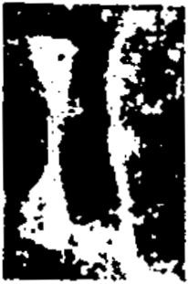

# obs-unk-004649 未释字档案

状态：未释字候选（HUST-OBC 数据集类别，未经交叉复核） | 释读史：未收集 | 例句：0 | 更新：2026-11-02

## 1 字形与观察

- 图 1：HUST-OBC 未释字 X 组第 205 类的一张样本，206 × 311 像素〔来源 src-hust-obc `HUST-OBC/undeciphered/X/205/X_？_8377_1.png`〕。
- 来源报告本类只有这一张样本。
- 观察：当前图像是高对比度且带有噪点的黑白派生图。
- 观察：一条高的浅色竖向区域两侧被深色区域包围。
- 观察：上下端部受到斑点状图像噪声遮挡。
- 观察：不规则深浅斑块使笔画边界无法可靠确定。
- 观察：不能依据此派生图记录构件或内部结构。

## 2 隶定与今字候选

- 数据集没有给出今字标签（来源文件名中以“？”表示）。

## 10 来源与权利

- 来源 src-hust-obc，图片资产 `asset-006242`，权利状态 `source_marked_risk_noted`。HUST-OBC 的 Figshare 与期刊页面许可表述不一致，详见来源档案 `corpus/006_research-sources-and-bibliography/001_source-objects/015_src-hust-obc_source-object/`。
- 图片 SHA-256：`eddb77eca92a55ae53b5533dff40d7c8270af48f67f4a0f6f30af540faf3aed1`；来源包 `large-src-000001`。

## 11 待查项

- 本类只有这一张样本，是孤例；在原拓或著录中找到它的出处后才能讨论释读。
- 在殷契文渊或小学堂字形库中检索近形字，记录比较结果与出处。
