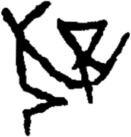

# obs-unk-004669 未释字档案

状态：未释字候选（HUST-OBC 数据集类别，未经交叉复核） | 释读史：未收集 | 例句：0 | 更新：2026-11-02

## 1 字形与观察

- 图 1：HUST-OBC 未释字 X 组第 225 类的一张样本，221 × 232 像素〔来源 src-hust-obc `HUST-OBC/undeciphered/X/225/X_？_7222_1.png`〕。
- 来源报告本类共有 6 张样本；本目录只保存其中一张。
- 观察：多条笔画在图像中央附近交叉。
- 观察：左侧组向上分叉，并继续形成向下的斜向笔画。
- 观察：右侧组围出一个小的倒三角形开口。
- 观察：一条弧形笔画从中央连接处向右上方延伸。
- 观察：中央连接处下方有一条短竖向笔画。
- 观察：来源元数据预期有六张图，但当前只有一张本地复核图；仍需获取另外五张来源视图。

## 2 隶定与今字候选

- 数据集没有给出今字标签（来源文件名中以“？”表示）。

## 10 来源与权利

- 来源 src-hust-obc，图片资产 `asset-006262`，权利状态 `source_marked_risk_noted`。HUST-OBC 的 Figshare 与期刊页面许可表述不一致，详见来源档案 `corpus/006_research-sources-and-bibliography/001_source-objects/015_src-hust-obc_source-object/`。
- 图片 SHA-256：`70ac616db2140aad0c15d76a25b9d4ddddd66840995b33bde1f57f750e50edea`；来源包 `large-src-000001`。

## 11 待查项

- 查看 HUST-OBC 本类其余样本（来源报告共 6 张）的文件名，确认是否带有著录号，并检查它们是否真是同一字。
- 在殷契文渊或小学堂字形库中检索近形字，记录比较结果与出处。
